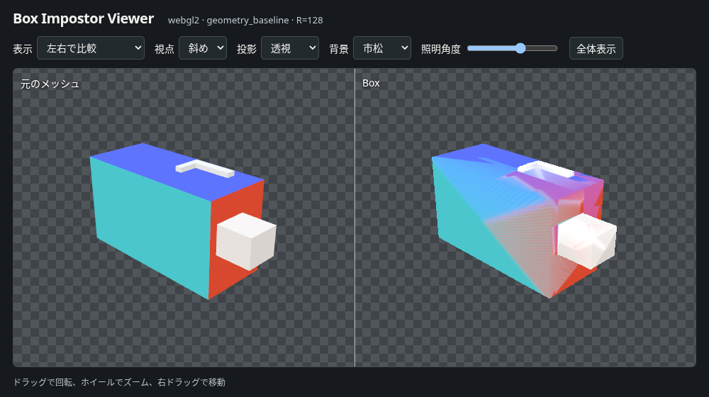

# ComfyUI Box Impostor Factory

GLBから6方向の正投影ガイドとthree-impostor互換のBoxアセットを作るComfyUIカスタムノード。元メッシュとBoxを同じカメラで比較できる。1面だけ色を変更しても、ベイク済みの法線・区間・占有範囲のマップを再利用する。

| 経路 | 検証状況 |
|---|---|
| GLB → Box → 保存 → 再読込 | 実際のChromiumでWebGL2とWebGPUのソフトウェア描画を確認。6軸と12斜視で、ベイク直後と別プロセスで読み込んだBoxの色・深度を比較。 |
| ComfyUI、手動画像、プレビュー | CPU版ComfyUIの画面から01と04を読み込み、GLBのベイクと手動6面の採用を確認。キューで保存・再読込と1面更新も実行。ブラウザでメッシュとBoxの左右比較、視点変更、アトラス表示を操作。 |
| Pixal3D、Qwen-Image 2.1＋AnyAngle、MiniMax H3-Image | 実際のComfyUI画面で各ワークフローを実行用グラフに展開し、画像・ガイドの接続を検査。対象モデルでの推論、必要VRAM、背面・上下面の生成品質は未測定。 |

## ComfyUIでGLBを開く

Node.js 22以上、ComfyUIを実行するPython 3.11以上を使用する。以下の `python` はComfyUIと同じ環境の実行ファイルを指す。Windowsのポータブル版では同梱のPythonを指定する。

```sh
cd ComfyUI/custom_nodes
git clone https://github.com/zkamiyama/ComfyUI-Box-Impostor-Factory.git
cd ComfyUI-Box-Impostor-Factory
python -m pip install -r requirements.txt
npm ci
npx playwright install chromium --only-shell
node tests/make_fixture.mjs ../../input/asymmetric.glb
```

LinuxでChromiumのシステムライブラリも必要な場合は `npx playwright install --with-deps chromium --only-shell` を使う。既存のChromiumを使う場合は環境変数 `BI_CHROMIUM` に実行ファイルの絶対パスを設定する。

ComfyUIを再起動し、[01_box_from_glb.json](workflows/01_box_from_glb.json) を画面にドロップして実行する。最初のノードのファイル名は `asymmetric.glb`。自分のGLBを使うときはComfyUIの `input/` に置き、この欄を変更する。正面を合わせるには `BI CanonicalizeProxy` の各軸の回転角（度）を指定する。

`BI PreviewBox` のボタンからビューアを開く。「左右で比較」を選ぶと、左にプロキシ、右にBoxが表示される。背景、照明、正投影／透視、6方向を切り替えられる。「アトラス・ガイド」では方向別の入力や区間・占有範囲も確認できる。

## ComfyUIを起動せずに試す

上記のリポジトリ直下で実行する。次の例は手続き生成した直方体で、行パディングの生じるR=128を検査する。`--verify` は保存後にChromiumを起動し直し、18方向の色・深度と輪郭を比較する。空の画像同士の一致は失敗として扱う。

```sh
node tests/make_fixture.mjs .test-output/asymmetric.glb
node worker/cli.mjs bake --input .test-output/asymmetric.glb --output .test-output/box --resolution 128 --backend webgl2 --maps roughness,metalness,ao --verify --evidence .test-output/evidence
node worker/cli.mjs inspect --asset .test-output/box
node worker/cli.mjs preview --asset .test-output/box
```

同じ非対称GLBを1面1024画素（カラーアトラス3072×2048）でも検証した。WebGL2・WebGPUとも、ベイク直後と新しいChromiumで再読込した後の18視点を各64×64で比較し、色・深度・輪郭の差は0だった。保存済みのBoxから1024×1024の透過PNGを書き出す試験も実施した。実機のVRAM使用量と1面2048画素のベイクは未測定。[R=1024の計測条件と結果](docs/verification/high-resolution-roundtrip.json)

最後のコマンドが表示するローカルURLを開く。PNGだけを出力する場合は `node worker/cli.mjs thumbnail --asset .test-output/box --output .test-output/hero.png` を使う。自動選択には `--backend auto`、WebGPUを必須にするには `--backend webgpu` を指定する。CIと同じソフトウェア描画を試す環境変数は `BI_SOFTWARE_GPU=1`。入力や設定を変えたときは別の出力ディレクトリを選ぶ。

## ワークフローと入力

| ファイル | 入力と使い方 |
|---|---|
| [01　GLBからBox](workflows/01_box_from_glb.json) | 外部リソースを内包するGLB。モデルの重みは不要。 |
| [02　参照画像からQwen](workflows/02_box_from_reference_qwen21.json) | 元画像を1枚指定する。Pixal3Dのテクスチャ付きGLBと6面ガイドを作り、元画像と各ガイドをQwen＋AnyAngleへ接続する。 |
| [03　参照画像からH3](workflows/03_box_from_reference_h3.json) | H3専用の分岐を使用する。共有の切り替えで、ガイドを編集する条件と元画像を編集する条件を比較できる。同じ面・seedで試す。 |
| [04　手動6面](workflows/04_manual_six_faces.json) | `input/` のGLBと `px.png, nx.png, py.png, ny.png, pz.png, nz.png` を指定する。前景アルファのあるPNGを使う。1面だけを適用するときは、ほかの入力枝を `BI FaceInputs` から外す。 |
| [05　Pixal3DからBox](workflows/05_pixal3d_baseline.json) | 参照画像から得たプロキシのベース色を使う。画像編集モデルを読み込まずに形状とカメラを確認できる。 |
| [06　保存済みBoxの1面を交換](workflows/06_replace_saved_face.json) | 現在のアセットIDまたは書き出し名と、交換したい面のPNGを指定する。初期接続は＋X。別の面に差すときは `BI FaceInputs` の接続先を変える。他の5面の色と幾何マップを保持する。 |
| [07　保存済みBoxを透過PNGにする](workflows/07_render_saved_box.json) | 先頭の `BI LoadBox` に自分のアセットIDまたは書き出し名を指定する。初期値は `fixture`。標準ノードで `IMAGE` と `MASK` を結合し、`output/BoxImpostor/` に透過PNGを保存する。 |
| [08　TripoSplatの追加ガイド](workflows/08_triposplat_guide.json) | 同じ物体の参照画像とGLBを指定し、位置を合わせたスプラットを選んだ面に投影する。デコードしたガウスのパラメータを保存し、別の面から見るときも再利用する。 |
| [09　修正GLBで形状を更新](workflows/09_rebake_proxy_revision.json) | 元のアセットIDまたは書き出し名と、同じ原点・単位・軸で編集したGLBを指定する。初期値は `fixture` と `corrected.glb`。新しいBoxと、修正前後の計測結果を出力する。 |

02・03・05のモデルファイル名は各ローダーに設定済み。必要な重みと配置は公式テンプレートに従う。Qwenの第1画像は元画像、第2画像はガイド。LoRAはモデル側だけに適用する。H3では第1画像が編集対象になる。ガイドは余白を加えてモデルの正方形入力へ収める。生成後は同じ変換を逆にたどり、ガイドの画角に戻す。面別seedを変更すると、その面の生成からやり直せる。[Pixal3D](https://github.com/Comfy-Org/workflow_templates/blob/a8bc07a76478dfada740fa8fa49ac87be1bff519/templates/3d_pixal3d_trellis2_image_to_model.json) · [Qwen](https://github.com/Comfy-Org/workflow_templates/blob/a8bc07a76478dfada740fa8fa49ac87be1bff519/templates/image_qwen_image_2_1_image_edit.json) · [AnyAngle](https://huggingface.co/lilylilith/QI_2.1_AnyAngle) · [H3](https://github.com/Comfy-Org/workflow_templates/blob/a8bc07a76478dfada740fa8fa49ac87be1bff519/templates/image_minimax_h3_image_edit.json)

## BoxをIMAGEとしてレンダリング

`BI RenderBox` は保存済みのBoxを指定方向から描画し、透過PNG相当の `IMAGE` とComfyUI方式の `MASK`（背景=1）を出力する。画角は正投影・透視から、視点は6軸と斜め方向から選ぶ。幅・高さは64〜2048px。出力は条件別にキャッシュし、元の `colorMap`、`intervalMap`、`rangeMap` を変更しない。

`BI PreviewBox` の `IMAGE` サムネイルでも `sampling` を選べる。標準は `standard`。硬い境界の色にじみを抑えたい場合だけ `reduce_bleeding` を使う。この設定は描画時の `intervalMap` サンプリングを最近傍にするもので、穴・細部や深度が悪化する場合がある。ビューアでも「補間」から切り替えられる。

CLIから画像を得る場合:

```sh
node worker/cli.mjs render --asset .test-output/box --output .test-output/side.png --view +Z --projection orthographic --width 512 --height 512 --sampling reduce_bleeding
```

## 実モデルで1面から試す

ComfyUIの `input/` に参照画像を置き、ComfyUIを起動した状態で、リポジトリのルートから実行する。最初のコマンドで、起動中のComfyUIが認識しているモデル・ノード・参照画像を照合する。

```sh
node scripts/run_model_workflow.mjs --model qwen --input reference.png
node scripts/run_model_workflow.mjs --model qwen --input reference.png --face=+Z --run
```

全6面を生成するには `--face=+Z` を外す。H3は `--model h3`、Pixal3DによるGLBとBoxの確認は `--model pixal3d` を使う。ComfyUIの接続先は `--origin` で指定できる。実行記録は既定で `.test-output/models/` に残る。各面の採否と理由、実際に動いたサンプラー、ガイドと生成画像はその記録で確認できる。重みを同じファイル名で交換した場合はComfyUIを再起動する。

## TripoSplatをガイドに使う

`BI TripoSplatGuide` にComfyUIの `SPLAT` と、同じ物体のGLBから作った `BI MakeSixGuides` の `guides` をつなぐ。`face_id` で方向を選び、スプラットを元のGLBに位置合わせした場合は `source_glb`、正規化後のGLBに合わせた場合は `canonical_box` を指定する。位置・向き・スケールが違う場合は上流の `Transform Splat` で合わせる。

コマンドで試すには `node scripts/run_model_workflow.mjs --model triposplat --input reference.png --mesh matching.glb --face=+Z` を実行する。参照画像とGLBをComfyUIの `input/` に置く。重みとGLBの事前確認が通ったら `--run` を付ける。ガイド画像、同じ面のメッシュ画像、輪郭・深度の計測値を保存する。

出力の `guide` は画像生成に渡すRGB画像、`foreground` は物体を1とするマスク。`qa_json` でメッシュとの輪郭IoU、境界距離、重なる画素の深度順位相関を確認できる。Boxの法線・区間・占有範囲は、この場合もGLBからベイクする。

## 保存・再利用・品質の確認

ComfyUIでは `output/box_impostor/<asset_id>/manifest.json` がアセットの入口になる。GLB、RGBA16Fの幾何マップ、カラー、6方向のガイドと深度をまとめて参照する。`BI BakeBox` の `material_maps` でroughness・metalness・AOやemissiveを選べる。roughness・metalness・AOは上流と同じRGBA8アトラスに保存する。`BI SaveBox` で `output/box_impostor_exports/<name>/` に書き出し、`BI LoadBox` でアセットID・書き出し名・SaveBoxの出力パス・inputからの相対manifestパスを指定する。

Boxを1ファイルで渡すには `BI PackBox` にアセットと書き出し名をつなぐ。`output/box_impostor_exports/<name>.box.zip` に、GLB、manifest、各マップ、ガイド、QAを可逆圧縮する。`BI LoadBox` は書き出したZIPのパスや `input/` に置いたZIPの相対パスも開ける。展開時に各マップを検証し、同じZIPを再度開くときは取り込み済みのアセットを使う。

手動・生成画像の整列では前景輪郭を比較する。採用した面でも元のアトラスのcoverageは保持し、線形RGBだけを合成する。輪郭が基準を満たさない指定面はプロキシのベース色に戻す。結果の `qa/report.json` に方向別の理由と、深度で照合できた共通表面の色差が残る。直方体のように隣接カメラから同じ面がほとんど見えない場合は比較不能として扱う。

ビューアの「6面の採否」を開くと、各面の表示色と判定理由が分かる。`BI InspectFaceSilhouette` は、生成画像を元のガイドの画角に戻し、**位置合わせ前**の前景を重ねて表示する。オレンジは生成・手動画像にだけある領域、水色はGLBのガイドにだけある領域。それぞれを個別のマスクとして取り出せる。面画像やカメラ変換が足りない場合は、計測できなかった理由を `qa_json` に記録する。

修正したGLBを採用するときは、09の `BI RebakeProxyRevision` を使う。元のBoxの解像度とマテリアルマップの選択を引き継ぎ、修正GLBから6方向のガイド、カラー、幾何マップを作り直す。元のアセットIDは引き続き使える。同じプロキシを渡した場合は既存のBoxを返す。`qa/geometry-revision.json` には元のGLBの座標系で比較した方向別の輪郭の重なりと深度差、相手の画角から外れた前景画素数が残る。視線方向が異なる面は比較不能として記録する。

保存前後の一致と、元メッシュに対する近似精度は別々に測る。下の比較では、斜めから見た輪郭は近いが、硬い辺を持つ物体のBox内部に隣の面の色が混じる。これは元のBakerで描いた段階から再現する。[18視点での元メッシュとの比較値](docs/verification/proxy-box-r128.json)



元メッシュの見え方を基準に、区間マップの補間だけを変更する診断も行った。同じ硬い辺を持つ直方体をR128でベイクし、正面6方向と斜視12方向で重なる前景画素を測った。深度はカメラのnearからfarを0〜1とした値。どちらも誤差が小さいほど元メッシュに近い。

| 同じアセットの描画条件 | 色の平均絶対誤差（8bit、18方向の平均） | 深度誤差の95パーセンタイル（18方向の最大） |
|---|---:|---:|
| three-impostor 0.4.1の標準 | 22.29 / 255 | 0.001716 |
| intervalMapのみ最近傍補間（比較実験） | 2.10 / 255 | 0.002209 |

貫通穴を持つ薄い枠でも比較した。最近傍補間で色の平均誤差は22.48から7.84に下がり、最も輪郭が崩れた視点のシルエットIoUは0.825から0.934に上がった（1が完全一致）。穴を見通せた10方向の計6,799画素のうち、標準ではすべて背景のまま、最近傍補間では11画素が物体の色で埋まった。配布版は上流の標準設定を使用する。[色付き直方体の比較画像](docs/verification/color-fringe-comparison.png) · [直方体の18方向の計測値](docs/verification/color-fringe-comparison.json) · [開いた枠の18方向の計測値](docs/verification/open-frame-r128.json)

別のGLBでも、上記のCLIでベイクした後に `node tests/compare_proxy.mjs .test-output/box .test-output/comparison.json webgl2 --compare-interval` を実行すると、同じアセットを使って両方の補間を比較できる。枠のGLBは `node tests/make_open_frame.mjs .test-output/open-frame.glb` で作成できる。

## テストと設計資料

```sh
npm test
python -m unittest discover -s tests -p 'test_*.py' -v
```

GPU付きブラウザを使うビューア試験は `BI_TEST_ASSET` にベイク済みアセットを指定して実行する。GitHub Actionsでは描画結果とmanifestを バックエンド別の `box-roundtrip-*` アーティファクトに保存する。ComfyUI統合試験は固定コミットの本体を起動し、HTTPキュー、書き出し、再読込、1面更新を検査する。さらに配布用JSONをブラウザで読み込み、01・04・07・09を実行する。モデルを使うワークフローは実行用グラフに展開し、記録は `comfy-frontend-workflows` に保存する。[ブラウザ試験](https://github.com/zkamiyama/ComfyUI-Box-Impostor-Factory/actions/workflows/box-roundtrip.yml) · [ComfyUI試験](https://github.com/zkamiyama/ComfyUI-Box-Impostor-Factory/actions/workflows/comfy-native.yml) · [実装指示書](docs/ComfyUI_BoxImpostor_Agent_Handoff.md) · [先行研究](docs/research.md)

このリポジトリのコードはMIT。ワークフローの出典とライセンスは [Comfy-Orgの表記](workflows/LICENSE-Comfy-Org.txt) に収録した。モデル本体とLoRAは各配布元の条件に従う。Qwen-Image 2.1本体の商用利用は別ライセンスを要する。H3の公開ウェイトには利用地域および出力の取り扱いに条件がある。[Qwen本体のライセンス](https://huggingface.co/Qwen/Qwen-Image-2.1/blob/main/LICENSE) · [H3のライセンス](https://huggingface.co/MiniMaxAI/MiniMax-H3-Image/blob/main/LICENSE)
