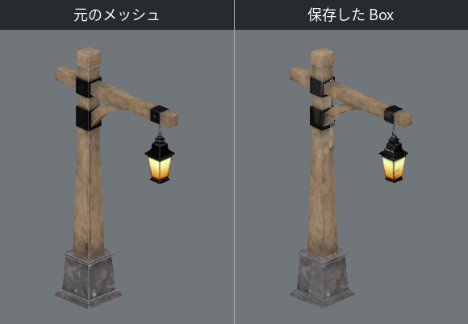
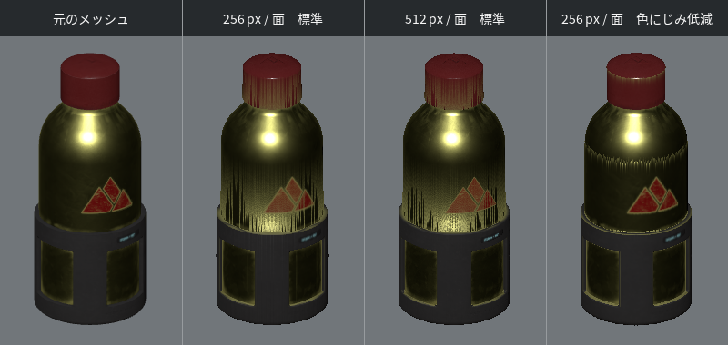
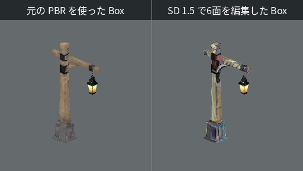
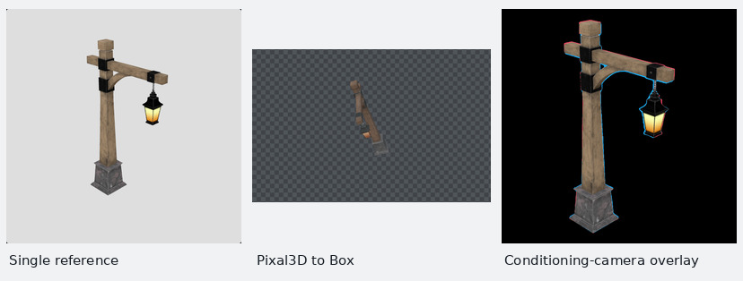
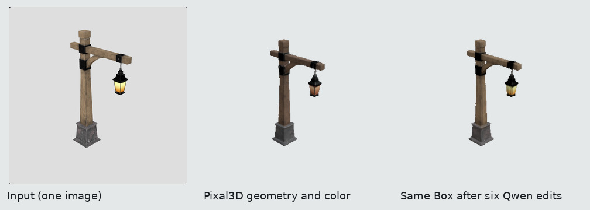

# CC0の街灯と金属ボトルでの検証

Khronosが配布しているMicrosoft製のGLBを使った。Lanternは木の支柱と吊り下げ式の灯具を含む5,394三角形のモデル。Water Bottleは赤いキャップと金属製の胴を持つ4,510三角形のモデルで、ラフネス、メタルネス、AO、法線、発光の各テクスチャを検査できる。どちらもCC0 1.0で公開されている。[Lanternの配布元](https://github.com/KhronosGroup/glTF-Sample-Assets/blob/8f492390ddc7a2ae221a1369ef560589cf8c70fb/Models/Lantern/README.md#legal) · [Water Bottleの配布元](https://github.com/KhronosGroup/glTF-Sample-Assets/blob/8f492390ddc7a2ae221a1369ef560589cf8c70fb/Models/WaterBottle/README.md#legal)

## 元メッシュとBoxの比較

元メッシュと保存したBoxを同じカメラと照明で描いた。比較画像は256×256画素。6軸と斜め12方向で、輪郭の重なり（IoU、完全一致は1）と、両方に物体が写った画素のRGB平均絶対誤差を測った。描画にはChromiumのSwiftShaderを使用した。

| モデル | 1面の解像度 | 描画方式 | 6軸の平均IoU | 斜め12方向の平均IoU | 18方向の平均RGB誤差（0–255） |
|---|---:|---|---:|---:|---:|
| Lantern | 256 px | WebGL2 | 0.9614 | 0.9625 | 4.73 |
| Lantern | 256 px | WebGPU | 0.9623 | 0.9667 | 4.77 |
| Lantern | 512 px | WebGPU | 0.9775 | 0.9816 | 4.01 |
| Water Bottle | 256 px | WebGL2 | 0.9951 | 0.9958 | 2.02 |

街灯の支柱と灯具の発光はBoxにも写った。真上から見ると台座の角が削れ、正面では細い吊り鎖が途切れる。WebGPUで1面を256 pxから512 pxに上げると、真上のIoUは0.906から0.946に改善した。正面で鎖が写る13画素のうちBoxでも見えたのは8画素から10画素に増えた。[鎖と台座の拡大比較](lantern-details.png)



金属ボトルでは標準補間で胴とキャップに縦筋が出た。1面を512 pxに上げても胴の縦筋は残る。1面256 pxで描画時の「色にじみ低減」を選ぶと、18方向の平均RGB誤差が2.02から1.34に下がった。肩とホルダーの縁には細い筋が残り、最も輪郭の差が大きい方向のIoUは0.992から0.982に下がった。



WebGL2とWebGPUの両方で、ベイク直後と新しいブラウザで再読込したBoxを64×64画素・18方向で比較した。両モデルとも色、深度、輪郭が全画素で一致した。ボトルの6面から選んだ14点では、元のGLBの三角形とUVから各PBR値を求め、アトラスの値と照合した。WebGL2での最大誤差は、ラフネス・メタルネス・AOが0.88/255、法線の向きが0.90度だった。[各方向の計測値とPBR検査結果](measurements.json)

## SD 1.5で街灯の6面を編集

RTX 4080で各面のカラーガイドをSD 1.5のimg2imgに渡し、元のガイドから輪郭を取った。1面256 px、各6ステップ、denoise 0.5で、6個のサンプラーがすべて実行された。同じGLBをベイクし、チェックポイントを一度読み込んだ環境で、このキューの実行時間は6.00秒だった。

6面とも編集色を採用し、最終の斜視では前景4,509画素のうち4,441画素の色が変わった。編集前後で透明度は全画素一致し、法線・区間・占有範囲・材質・発光の5マップはバイト単位で一致した。[実行条件とマップのSHA-256](sd15.json)



[検証済みの街灯Box](../../../examples/cc0-lantern-sd15.box.zip) を `ComfyUI/input/` に置き、`BI LoadBox` に `cc0-lantern-sd15.box.zip` を指定すると開ける。ZIPを書き出して読み直した後の斜視もRGBA全画素が一致した。

## RTX 4080で参照画像から作った街灯

元の街灯を斜めから透視投影で撮影し、640 × 640 pxの画像を1枚だけワークフロー05に渡した。軽量設定のPixal3Dは4段すべてを実行し、75.71秒でベース色テクスチャとUV付きの97,924三角形のメッシュから1面256 pxのBoxを作った。1秒間隔で測ったGPU全体のメモリ使用量は最大13,132 MiBだった。

入力の切り抜きは1024 × 1024 px、推定水平画角は29.35度。メッシュを推定カメラに戻すと、元の前景マスクとのIoUは0.9513だった。下の右図では赤が欠け、青が余分な部分を示す。[実行記録・重み・ZIPのハッシュ](rtx4080-pixal3d.json)



元のCC0メッシュとも比較した。撮影時の向きを使い、参照方向の輪郭の高さと中心で一度だけ尺度と位置を合わせた。奥行き方向の原点は両メッシュの奥行き範囲の中点を合わせて決めた。参照画像に使わなかった7視点の平均IoUは0.861、真上は0.807だった。単画像で見えない台座の奥行きや鎖の細部に差が残る。[全視点の輪郭と深度](pixal3d-novel-views.json) · [元メッシュとの比較画像](pixal3d-novel-views.webp)

[PBR付きの生成済みBox](../../../examples/cc0-lantern-pixal3d-compact.box.zip) を `ComfyUI/input/` に置き、ワークフロー07の `BI LoadBox` にファイル名を指定すると開ける。ラフネス・メタルネス・AOを含み、ZIP再読込後の384 × 384 pxの斜視はRGBA全画素で一致した。発光マップは元のPixal3D出力に含まれていない。

同じ画像でワークフロー05の配布時の標準設定も実行した。元メッシュを固定した7視点から描き、解像度の違いを比較した。

| Pixal3D設定 | 実行時間 | 生成した三角形 | 入力マスクとのIoU | 未使用7視点の平均IoU | 真上 / 真下のIoU |
|---|---:|---:|---:|---:|---:|
| 軽量 | 75.71秒 | 97,924 | 0.9513 | 0.8609 | 0.807 / 0.821 |
| 標準 | 135.68秒 | 699,978 | 0.9624 | 0.8822 | 0.824 / 0.849 |

標準設定は4096 pxのUV・テクスチャを生成し、保存したBoxを新しいプロセスで開くと18方向すべてで色・深度・輪郭が一致した。標準設定のBoxにはカラー・法線・区間・占有範囲を保存した。埋め込んだGLBには粗さ・メタルネス・AOもある。1秒ごとに測ったボード全体の使用量は標準実行で最大10,336 MiBだった。軽量実行とは起動時のメモリ状態が異なる。[標準版のBox](../../../examples/cc0-lantern-pixal3d-default.box.zip) · [計測条件](pixal3d-profiles.json) · [標準版と元モデルの輪郭・深度](pixal3d-default-views.webp)

## Qwenで街灯の6面を編集

軽量版Pixal3Dの各面のガイドと元の参照画像をQwen-Image 2.1＋AnyAngleに渡した。512 px、24ステップ。位置合わせでは、許容範囲内の補正と元の配置のうち輪郭IoUの高い方を採る。基準を0.85に保ったまま、初期seedで5面が通った。真上だけseedを103から321に変えると、その面のIoUは0.8025から0.9316になり、6面すべてを採用できた。他の5面の生成PNGはバイト単位で一致した。[面ごとの採否・時間・メモリ](lantern-qwen.json) · [各生成画像と撮影方向の照合](qwen-view-correspondence.json)

形状を元のCC0 GLBに替えた対照実験でも、初回は6面中5面を採用した。真下だけseedを104から321に変えるとIoUが0.7147から0.8540に上がった。実際に動いたサンプラーは1個で、他の5面のPNGを再利用して全6面を採用した。[元メッシュを使った各面の記録](lantern-qwen.json)

正面の透視投影を384 × 384 pxで比較すると、前景8,561画素のうち8,343画素で色が変わった。透明度は全画素で一致し、法線・区間・占有範囲・材質アトラスのSHA-256も一致した。ZIPを独立に展開して再描画した結果はRGBA全画素で保存前と一致した。[編集済みPBR付きBox](../../../examples/cc0-lantern-pixal3d-qwen-pbr.box.zip) · [ZIPのハッシュと検査結果](lantern-qwen-archive.json)



[今回の参照画像](../../../examples/bi-cc0-lantern-reference.png) を `ComfyUI/input/` に置き、次のコマンドを実行する。1面分のseedだけを変えた場合、同じプロキシと他の5面の推論結果を再利用する。

```sh
node scripts/run_model_workflow.mjs --model qwen --input bi-cc0-lantern-reference.png --compact-proxy --size 512 --face-seed=+Y:321 --material-maps material+emissive --run
```

## RTX 4080でのベイクと描画時間

Windows版EdgeがNVIDIAのアダプターを選んだことを確認して計測した。1面1024 pxの街灯では、古い128ステップの探索上限により一部の斜視で画素が欠けていた。上限を解像度に合わせると18視点の最低IoUが0.469から0.983に上がった。1面2048 pxではアトラスをBlobで転送し、フルPBRのベイク、保存、別プロセスでの読込を完了した。

| 1面2048 pxの街灯 | ベイクから再読込まで | 元メッシュに対する最低IoU | 保存前後の色・深度・輪郭 |
|---|---:|---:|---|
| WebGPU | 12.88秒 | 0.9956 | 18方向すべて一致 |
| WebGL2 | 15.71秒 | 0.9956 | 18方向すべて一致 |

推論を止めて、1面256 pxのBoxと5,394三角形の元メッシュを同じカメラで描いた。1024 × 1024 pxに16個を表示したとき、WebGPUの1フレーム当たりの中央値は元メッシュ0.149 ms、Box 0.296 msだった。100フレームごとにGPUの読み戻しを待つオフスクリーン計測で、このモデルと表示条件では元メッシュが速かった。[全サイズ・個数・バックエンドの計測値](rtx4080-render.json)

WSLのComfyUIからWindowsのEdgeを使い、金属ボトルを登録済みノードでベイク、描画、ZIP出力した。ZIPを新しい保存先で読み込むと、WebGL2・WebGPUともにRGBA全画素が一致した。14点の粗さ・メタルネス・AOは、元のGLBを同じGPUで直接サンプリングした値との差が最大1/255。CPUの理論値との比較ではAOの1点が3.02094/255となり、許容値3/255を超えた。同じUVでGPUに縮小率を指定すると150、GPUが微分から縮小率を決めると153となり、ベイク値153を再現した。[実機のアダプター・画素・サンプラーの記録](rtx4080-comfy-waterbottle.json)

## TripoSplatの6面位置合わせ

同じ参照画像から公式のTripoSplatをRTX 4080で65.78秒実行し、262,144個のガウスを得た。元メッシュの6面ガイドに対し、全方向に共通の平行移動と軸別スケールを推定した。実際に再描画した6方向の平均IoUは0.545から0.812に改善した。側面は約0.96、真上は0.548、真下は0.561だった。面ごとの画像を別々に移動していない。[6面の輪郭・深度の数値](lantern-triposplat.json) · [位置合わせ前後の画像](lantern-triposplat.webp)

同じスプラットとBoxについて、ワークフロー08で `canonical_box` の6面を一度ずつ描く。次のコマンドで表示した値を、元の変換の後ろに追加した `TransformSplat` に入力する。

```sh
python scripts/fit_splat_guides.py /path/to/ComfyUI/output/box_impostor/ASSET_ID /path/to/guide-run/qa.json
```

## 再現手順

リポジトリ直下で次を実行する。ボトルの元データを固定リビジョンから取得し、材質と発光を含めてベイクする。

```sh
mkdir -p .test-output
curl -fL https://raw.githubusercontent.com/KhronosGroup/glTF-Sample-Assets/8f492390ddc7a2ae221a1369ef560589cf8c70fb/Models/WaterBottle/glTF-Binary/WaterBottle.glb -o .test-output/WaterBottle.glb
node worker/cli.mjs bake --input .test-output/WaterBottle.glb --output .test-output/bottle --resolution 256 --backend webgl2 --maps roughness,metalness,ao,emissive --verify
python tests/check_pbr_bake.py .test-output/WaterBottle.glb .test-output/bottle
node tests/compare_proxy.mjs .test-output/bottle .test-output/bottle-comparison.json webgl2 --size 256 --compare-interval
```

ComfyUIで自分のGLBを試すときは、ワークフロー01の `BI BakeBox` で `material_maps` を `material+emissive` にする。ビューアの「アトラス・ガイド」から `materialMap` のR（ラフネス）、G（メタルネス）、B（AO）を個別に表示できる。元モデルにAOテクスチャのない街灯では、物体の表面のAOは255になる。

街灯の6面生成を再現するには、SD 1.5のFP16チェックポイントと `input/Lantern.glb` を用意し、ComfyUIの起動中に実行する。[検証に使った街灯GLB](https://raw.githubusercontent.com/KhronosGroup/glTF-Sample-Assets/8f492390ddc7a2ae221a1369ef560589cf8c70fb/Models/Lantern/glTF-Binary/Lantern.glb)

```sh
python scripts/run_lightweight_smoke.py --mesh Lantern.glb --backend webgl2 --resolution 256 --steps 6 --seed 19590 --denoise 0.5 --material-maps material+emissive --positive-prompt "a weathered timber street-lamp post, crossbeam, hanging warm golden lantern, aged dark iron fittings, detailed wood grain, studio product photograph" --run
```
