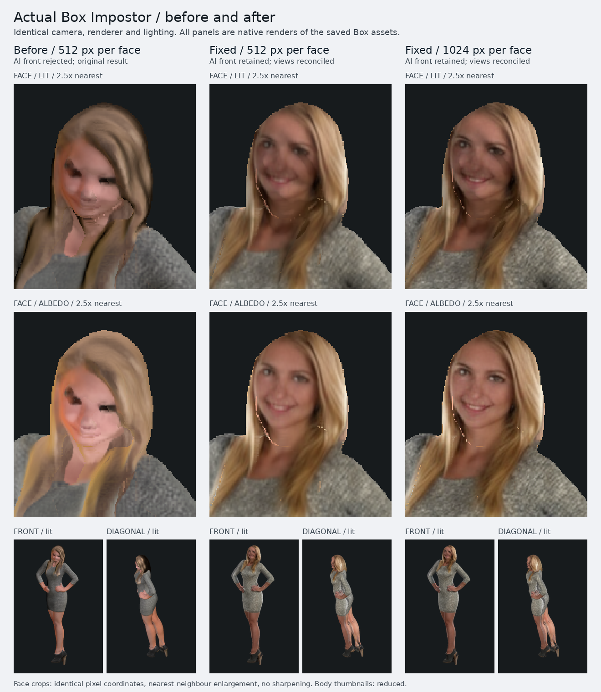

# 顔のディテール消失の調査と修正

検証日: 2026-11-19 JST

対象: ComfyUI-Box-Impostor-Factory / グレーの服の女性

## 結果

正面のAI画像が不採用になって粗い画像に戻る問題と、別の面の目・口が正面に重なる問題を修正した。512pxと1024pxのBox Impostorを実際に生成した。正面の顔は改善したが、斜め・横顔の顔の引き伸ばしと頬の不連続は未解消。再投影によって斜め方向の髪に大きな継ぎ目が増える副作用も確認した。

今回の主結果は既存の高精細なH3生成画像を保持し、面間の対応を修正したもの。元の粗い形状は維持している。SuperMatによる材質生成と、MoGe-2によるZの追加も別に実行して比較した。

- [1024pxの3D-Inspector](woman-detail-1024-3d-inspector.html)
- [512pxの3D-Inspector](woman-detail-512-3d-inspector.html)
- [修正前・修正後の実レンダー比較](final-comparison.webp)
- [検証記録](validation.json)

## どこで顔が崩れたか

### 正面のAI画像が採用されていなかった

元アセットの正面 `+Z` は `silhouette-iou` による `fallback` だった。輪郭のIoUは位置合わせ後でも0.770633で、採用基準0.85を満たさなかった。

最終アトラスの正面タイルを粗いベースのタイルと比較したところ、異なる値は0、最大差も0だった。正面にはSuperMatの適用記録もなかった。全体の `h3_enhanced` 表示だけでは正面もAI画像に置換されたとは判断できない。

したがって、元の正面の崩れを「高精細なAI画像が縮小で溶けた」とした説明は誤りだった。実際には高精細画像が正面の表示まで届いていなかった。

根拠: [元アセットと以前のNeural版の実測](root-cause.json)、[faces.py](../../../box_nodes/faces.py)、[material_pipeline.py](../../../box_nodes/material_pipeline.py)。

### 採用後も別の面の顔が混ざった

位置合わせを修正して全6面のAI画像を採用すると、今度は正面に目・口・顎の二重像が出た。通常のBox描画は正面方向でも正面タイルだけを使わず、複数面を重み付きで混合していた。

1024px版の顔の領域をGPU上で計測すると、平均寄与は正面 `+Z` が74.46%、`-X` が15.84%、`-Y` が5.46%、`+X` が4.01%、`+Y` が0.22%だった。首の領域では `-X` が23.09%寄与していた。各面で独立に描かれた顔の位置が一致しないまま混ざっていた。

正面タイルだけを使う診断表示では顔が明瞭だった。これは原因を切り分けるための診断であり、納品するビューアには使用していない。通常のマップはLOD 0で、ミップマップも無効だった。

根拠: [GPUで計測した各面の重み](native-face-weights.json)、[段階別の画像](diagnosis-stages.webp)、[再投影の比較](reprojection-variants.webp)。

### 材質推定でも細部が弱まった

SuperMatを512pxと1024pxで実行した。1024pxの方が目・口の細部を保持したが、元のH3画像より顔のコントラストが弱くなった。推定した材質マップでは顎や髪に強い光沢と黒く見える部分も出た。

同じ色・形状のまま、診断用に全体のmetalnessを0、roughnessを0.6以上にすると、その光沢と黒い部分が減った。albedo表示の最大差は0だったため、この部分は色や穴の欠損ではなく材質による見え方と切り分けられた。この一律の材質変更は製品の既定値にはしていない。

根拠: [材質解像度の比較](material-resolution.webp)、[材質生成1024pxの記録](material1024.json)、[材質生成512pxの記録](material512-on1024.json)、[細部保持の記録](material-detail-control.json)。

## 実装した修正

| 処理 | 修正内容 |
|---|---|
| AI画像の位置合わせ | 輪郭のIoUを使って許容範囲内の一様拡大・平行移動を探索する。採用基準0.85は維持する。 |
| 画像の再サンプリング | 元画像から1回の変換で登録する。小数のクロップ位置を維持し、材質画像にも同じ変換を使う。 |
| 面間の対応 | 採用済みの正面と同じ表面を見ている隣接面の画素へ、正面の色・法線・材質・発光を対応付ける。 |
| 遮蔽の判定 | 保存された深度とcoverageを使う。正面から見えない表面へは投影しない。 |
| 材質推定後の細部 | `detail_strength` でH3画像から輝度の高周波成分を補う。0で無効、比較では0.75を使用した。 |
| AIによるZの追加 | Zの予測にもRGBの採用済み位置合わせを適用し、不採用面を除外する。 |
| ワークフロー | 全6面の生成・ベイク・材質編集を1024pxにしたワークフロー13を追加する。 |

面間の対応処理はテクスチャ側に実装した。Boxのシェーダーや3D-Inspectorの表示方式を変更していない。元の形状、interval/range、coverage、正面タイル、反対側のタイルは維持する。

深度の許容差は `2 / resolution + 0.0005`、正面を補間したcoverageは0.9999より大きい画素を対象とした。法線の角度で除外すると、通常描画が混ぜる一部の画素を処理できず二重像が残ったため、保存深度の一致を基準にした。

実装: [view_reproject.py](../../../box_nodes/view_reproject.py)、[material_detail.py](../../../box_nodes/material_detail.py)、[neural_depth.py](../../../box_nodes/neural_depth.py)。

## 実測結果

| 指標 | 修正前 | 修正後 |
|---|---:|---:|
| 正面輪郭のIoU / 512px | 0.770633 | 0.888411 |
| 正面輪郭のIoU / 1024px | 元結果は512px | 0.888649 |
| 正面のAI画像 | 不採用 | 全6面で採用 |
| 顔の平均RGB差 / 255 | 26.0465 | 0.8796 |
| 顔のRGB差の95パーセンタイル | 97.6667 | 2.6667 |
| 差が8を超える画素 / 3,835画素 | 2,088 | 30 |

RGB差は同じ1024pxアセットの正面タイルだけを使った診断表示との差。面間対応の実装により平均差は約96.6%減った。これはAIが描いた正面の外観を保てた度合いを示す。実在人物の形状や顔の解剖学的な精度を96.6%改善したという意味ではない。

IoUも人物全体の輪郭の一致度であり、目・鼻・口の位置精度を直接測っていない。比較の条件と領域は [reprojection-front-fidelity.json](reprojection-front-fidelity.json) に記録した。

## 試した方法と判断

| 方法 | 確認した結果 | 判断 |
|---|---|---|
| 512pxから1024pxへ変更 | 細部の保持は改善するが、面間の二重像は残る | 対応処理と組み合わせて採用 |
| 輪郭の位置合わせ | 正面が基準0.85を超え、AI画像を採用できた | 採用 |
| 正面だけを表示する診断 | 目・口の二重像が消えた | 原因の切り分けに使用 |
| 保守的な再投影 | 二重像が一部残った | 最終方式には不採用 |
| 深度一致による再投影 | 通常のBox描画でも正面が明瞭になった | 採用 |
| 境界を2pxぼかす | 大きな横顔の不連続は解消しなかった | 不採用 |
| SuperMat 512px / 1024px | 1024pxで細部が残るが、H3の色を保持した結果の方が顔は明瞭だった | 材質生成の選択肢として維持 |
| SuperMat後に細部を補う | 目・口のコントラストを一部回復した | 選択式で実装 |
| metalness / roughnessの診断 | 強い光沢と黒い髪の一部を材質の影響と切り分けた | 診断に使用 |
| MoGe-2によるZの追加を2強度で実行 | 実際に形状は変化したが、顔の二重像は解消しなかった | 今回の主結果には不採用 |

MoGe-2はstrength 0.04 / 0.08、max_delta 0.004 / 0.008、sigma 20で実行した。予測画像とRGBの位置合わせを揃え、実際にメッシュを再ベイクして比較した。形状変更だけで今回の外観の問題を解消する結果は得られなかった。記録: [neural-trials.json](neural-trials.json)、[実レンダー比較](neural-depth-comparison.webp)。

## 使用方法

[workflows/13_box_from_reference_h3_detail_1024.json](../../../workflows/13_box_from_reference_h3_detail_1024.json) をComfyUIに読み込む。

このワークフローは `BIGenerateFaceMaterials` の `source=supermat`、`edit_resolution=1024`、`view_consistency=front`、`detail_strength=0.75` を既定値にしている。SuperMatを通した実出力も512px・1024pxの両方で確認した。

今回の主な3D-Inspector結果と同じく、H3が描いた目・口・髪を保持する場合は `source=keep`、`view_consistency=front` を選ぶ。材質推定後に細部を補う処理には、細かな照明表現を再び含める可能性がある。物理的に正しいalbedoを保証する設定ではない。

1024pxは各面の人物全体の解像度。顔だけを1024pxで生成した結果ではない。今回の比較では同じ既存のH3生成画像を使用し、後段の修正による差を確認した。

## 成果物の対応

| 結果 | アセットID |
|---|---|
| AI画像保持 + 面間対応 / 512px | `77cb3973214fbef0a54257982a516cc8e4eb7481357a48477f2f42d956c86b70` |
| AI画像保持 + 面間対応 / 1024px | `1b8a756f88c84570b17ab582caa55291f29df99b9e1a4800be00b8ab99a57c52` |
| SuperMat + 細部保持 + 面間対応 / 512px | `f060701ae896b60dc22eb3a813970af999b15748526aead0bbabf307e95e9ad1` |
| SuperMat + 細部保持 + 面間対応 / 1024px | `881a042a463f56572908d51b382c4ba2516e9c38da197e93026a353a1d28b52f` |

元データは270-PCの `/home/dev/Projects/box-impostor-lab/ComfyUI/output/box_impostor/` にある。生成と比較に使った作業記録は `/home/dev/Projects/box-impostor-lab/results/face-detail-recovery/` にある。

## 検証と残る問題

Pythonは106件中105件成功、1件スキップ。スキップは専用のComfyUIチェックアウトが必要なnative PLY往復テスト。ワークフローとパネルのJavaScriptテストは19件すべて成功した。`git diff --check` も成功した。

実際のSuperMat出力では512pxと1024pxの両方で全6面の採用、材質生成、細部保持、面間対応の記録を確認し、テクスチャのハッシュも検証した。詳細: [validation.json](validation.json)。

斜め・横顔の破綻は未解消。側面の顔の歪みは再投影前にも存在し、再投影後は髪に大きなパッチと継ぎ目が追加された。全方向で改善した結果とはいえない。今回の面間対応は正面と同じ表面が見える範囲を揃える処理で、隠れている横顔まで正しい形状に再構成する処理ではない。既存ワークフローは維持し、正面の外観を優先する選択式の処理として実装した。

## 閲覧ファイルと追加の証拠

3D-Inspectorの公式 `view.py` が出力したHTMLを変更せずに収録した。512pxと1024pxのHTMLは、それぞれ元のBoxアセットのマップとハッシュが一致する。元結果と両修正版を実際に読み込み、正面・背面・左右・斜めの描画でエラーがないことを確認した。

1024pxの閲覧用ZIPは元マニフェストと参照先のファイルを変更せずにまとめたもの。作成途中のキャッシュを含む完全なアーカイブも270-PCに保持している。書き出しの情報とハッシュは [export-provenance.json](export-provenance.json) に記録した。

- [3D-Inspectorでの正面・斜め・左右の比較](inspector-angle-heads.webp)
- [再投影によって悪化した斜め方向の髪](reprojection-diagonal-regression.webp)
- [同じ照明でのH3・SuperMat・細部保持の比較](material-render-comparison.webp)
- [材質による光沢を切り分けた比較](material-shading-control.webp)
- [材質の比較で色が不変だったことの記録](material-shading-control.json)

比較画像の作成条件は [final-comparison-provenance.json](final-comparison-provenance.json) にある。顔の拡大は同じ座標を切り出した2.5倍のnearest拡大で、シャープ化は行っていない。
