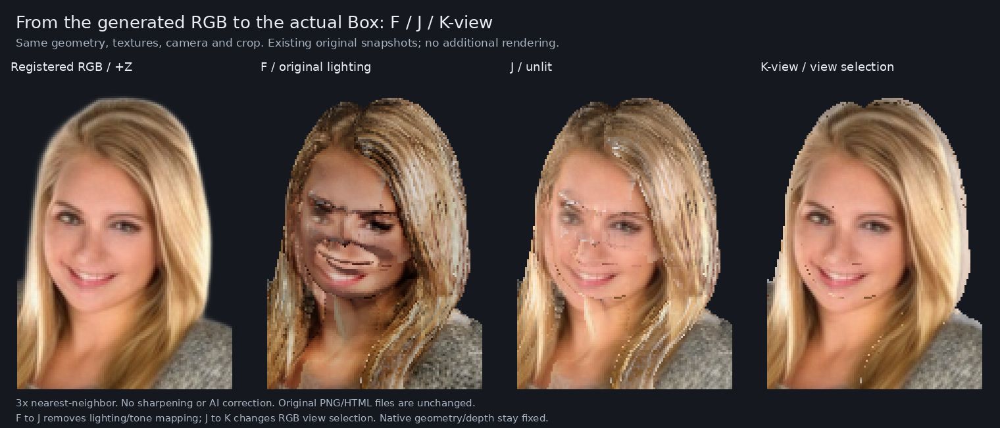
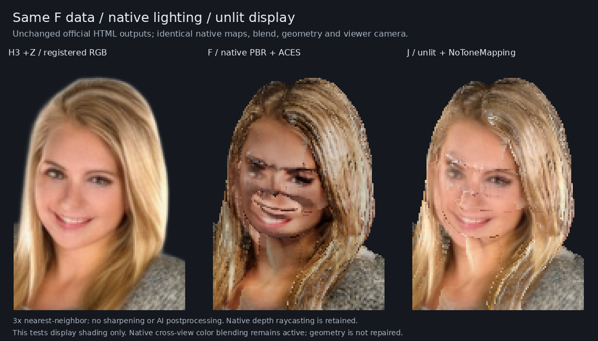
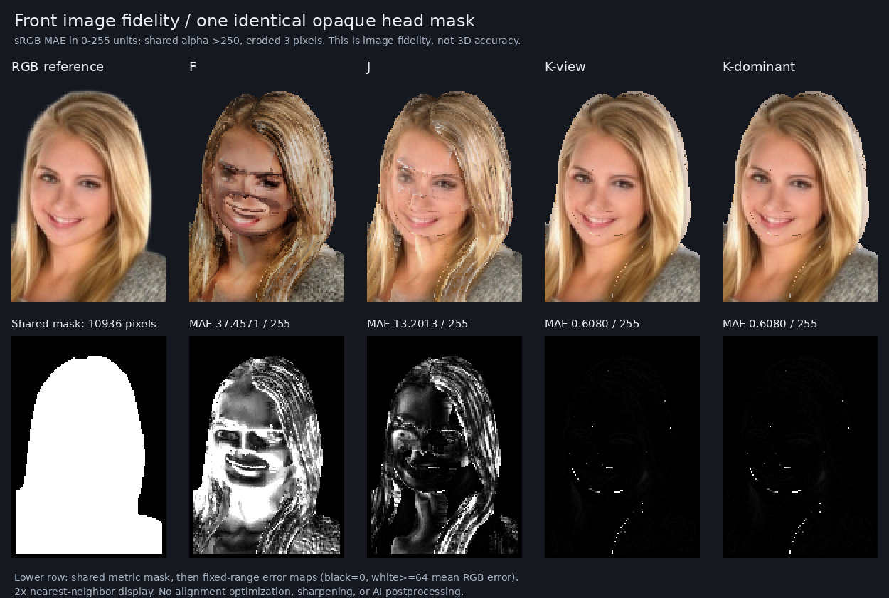
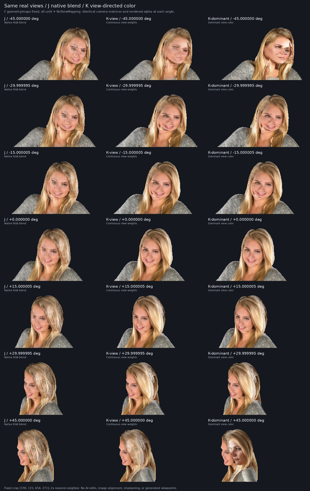
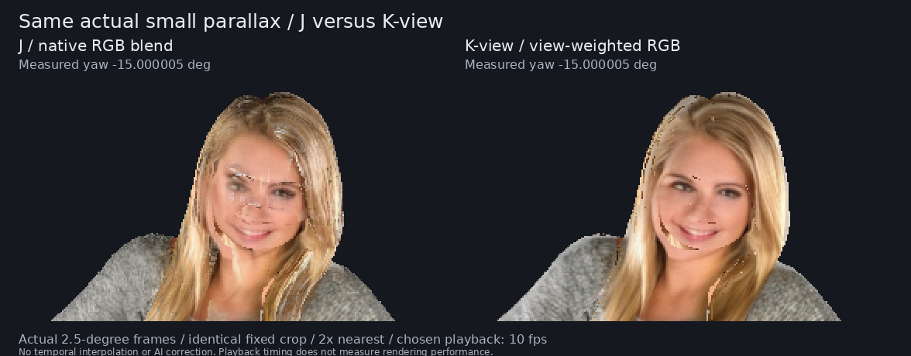

# 生成RGBを保つ視差Boxの検証

実験: `hi3d-depth-cycle-20261119`。正面、左右45°までの静止画、左右15°の実描画フレーム列を検証しました。

## 目的と現在の結果

目標は生成 RGB に描かれた目・鼻・口・髪を保ちながら、視点移動に応じた自然な視差を出すことです。
同じ F の形状と全マップを使い、J で追加の照明と トーンマッピング を外し、K で表示色の選び方を変えました。

K の正面では、目・鼻・口・髪が登録済みの正面 RGB にほぼ戻りました。
鼻・頬・顎には少数の点線状の乱れが残っています。
これは同一データの表示を改善した結果で、3D形状の精度向上を示す結果ではありません。[1] [2]

## 1. 比較した設定

| 試験 | 照明・トーンマッピング | 表示色の選び方 |
|---|---|---|
| F | 従来の照明・ACES | native の混合 |
| J | unlit・NoToneMapping | native の混合を維持 |
| K-view | J と同じ | カメラ方向に応じた view の重みで選択 |
| K-dominant | J と同じ | 主となる view を選択 |

全試験は同じ F asset を使っています。J/K の比較で形状やマップを生成し直していません。
K では元の描画処理による交差位置・輪郭・深度・法線を維持し、色を選ぶ処理だけを変更しました。[8]
J と K の正面カメラは一致し、描画 PNG の alpha も K-view / K-dominant とも J に完全一致しています。[1]

## 2. Jで分かったこと

J では目の周囲と鼻下・口の黒い帯が薄くなりましたが、native の色混合を残した表示には細い顔の線が残りました。
F→J で変更したのは、追加照明と ACES トーンマッピング の両方です。この比較を照明だけの効果とは扱いません。[3]

## 3. Kの正面と画素差

J→K では unlit / NoToneMapping を維持したまま、色の選び方だけを変更しました。
K-view と K-dominant の正面フレームは同じ SHA で、今回の正面では同じ画素になっています。[1]

| 表示 | 登録済み正面RGBに対するMAE |
|---|---:|
| F | 37.4571 |
| J | 13.2013 |
| K-view | 0.6080 |
| K-dominant | 0.6080 |

MAE は0〜255 の8bit sRGB値で求めた R/G/B 全サンプルの平均絶対差です。
基準は採用済みの +Z の `aligned.npy` を同じ正投影カメラの画素中心へ配置した画像です。
raw の生成画像を任意に位置合わせした比較ではありません。[2]

参照画像と全描画の alpha が250を超える共通領域を取り、その領域を3px縮めた頭部10,936pxで測りました。
画像ごとの mask、露出合わせ、誤差を小さくするための追加の位置合わせは使っていません。
この数値は正面画像の保持を測るもので、実物の形状との誤差や自然な視差の評価値ではありません。[2]

同一カメラ、同じ整数 crop、最近傍拡大、lossless WebP で比較図を作っています。画像の描き直しや強調はしていません。[1] [3]

## 4. 斜め方向の結果

J/K は正面と左右15°・30°・45°を撮影済みです。実カメラの角度を記録し、同じ頭部の範囲から共通 crop を作っています。[4] [5]
同一角度の実画像を比較した結果は次のとおりです。

| 正面からの角度 | Kの実画像で確認した結果 |
|---|---|
| 左右15° | K-view / K-dominant とも顔を保持 |
| 左右30° | Jの混色線より改善するが、髪に縞や欠けが残る |
| 左右45° | K-viewには混色、K-dominantには強い別顔・二重顔が残る |

+45°では、髪の中にもう一つの顔が明瞭に見えます。
今回採用する範囲は、検証した正面付近の左右15°での視差表示です。[5]

## 5. 小さな視差の確認

左右15°を2.5°刻みで撮影した13視点を、24フレームの往復再生にしました。
J と K-view の全13視点で実カメラ行列と描画alphaが一致しています。顔と全身の出力48フレームを復号し、組版元との画素完全一致も確認しました。
10 fps は比較用の再生設定です。処理速度を測った値ではありません。フレーム補間は使っていません。[6]

実フレーム列では、K-view は目・鼻・口・髪を保ちながら、向きと輪郭が変わります。
正面の低い MAE に加え、同じ角度のJ/K比較から、小さな視差で顔を保てることを確認しました。広角の問題は前節のとおり残っています。

[全身の視差フレーム列](K-view-parallax-body-loop.webp)も保存しています。

### 正面の点線状の残差

共通マスクとは別に、参照RGBのalphaだけから頭部内側10,953pxを取りました。この領域でKの透明画素と部分透明画素はともに0です。
鼻・頬・顎の小さな点線はこの評価域では不透明な画素の局所的なRGB誤差です。
1画素のRGB平均絶対差が16階調を超える画素は40px（0.365%）でした。顔の固定矩形4,287pxでは24px（0.560%）です。[7]

この分類だけで、誤差が元の色へ戻す処理、投影、深度、メッシュのどれに由来するかは断定していません。
髪の外輪郭や斜めから見た首境界は、この内側・正面の集計には含めていません。

## 6. 使用する設定

正面付近の左右15°の視差表示には `view` を採用します。`dominant` は比較用として残します。既存のコマンドの既定値は `lit` / `native` で、今回の成果物には下記の設定を指定しています。

| 経路 | K-viewの指定 |
|---|---|
| Factory | `--lighting unlit --color-sampling view` |
| 3D-Inspector | `--box-lighting unlit --box-color-sampling view` |

3D-Inspector のソースに表示オプションを追加し、`view.py` が生成したHTMLを変更せずに撮影・配布しています。

- [K-viewの保存版（gzip）](https://raw.githubusercontent.com/zkamiyama/ComfyUI-Box-Impostor-Factory/c9ce9a72213f0d4ea4b7f4a576a27db7327b4bea/docs/verification/hi3d-depth-cycle-20261119/K-view.inspector.html.gz)：今回選んだ表示。
- [K-dominantの保存版（gzip）](https://raw.githubusercontent.com/zkamiyama/ComfyUI-Box-Impostor-Factory/c9ce9a72213f0d4ea4b7f4a576a27db7327b4bea/docs/verification/hi3d-depth-cycle-20261119/K-dominant.inspector.html.gz)：広角の切替を調べる対照。
- Factoryの実装: `734c915e6d89919ac9135e06476bff85b33954d6`。
- Inspectorの実装: `66614346c951b77652fc64be54efddeb758e2c52`。
- 小視差の検証: `092c11f08d1f0879e7659485a284940abd5a2708`。
- HTMLの圧縮保存: `c9ce9a72213f0d4ea4b7f4a576a27db7327b4bea`、branch `verification/hi3d-depth-cycle-20261119-viewers`。

保存版を展開すると3D-InspectorのHTMLになります。展開した内容が生成原本とバイト単位で一致することを確認しています。

## 7. 今回の結論の範囲

同じ形状とマップのまま、正面RGBに対する頭部のMAEはFの37.4571からK-viewの0.6080に減りました。[2]
少なくとも今回の F asset の正面では、表示処理を修正することで顔の見え方を大きく戻せています。
残る不透明な色誤差と、広い角度での混色・別顔は未解決です。

今回の改善範囲はこの素材の正面付近での表示です。RGBと描画は全身1024×1024を基準とし、顔の比較図は同じ画像からの切り出しです。
直前のHの形状更新とIの頭部試験については [過去の検証報告](RESUME-REPORT.ja.md) にまとめています。

## 画像と検証記録

対象 asset: `4e8090f307b4958de8a94877ad391b3b0e355fa208d7ded8340a229e773b1920`。
正面と斜め方向の所見は、取りまとめ担当と評価担当の実画像確認に基づきます。
形状の実測正解はなく、本稿のMAEを3D形状の精度としては扱いません。

[1]: K-front-provenance.json
[2]: F-J-K-front-fidelity.json
[3]: J-front-provenance.json
[4]: J-yaw-provenance.json
[5]: J-K-yaw-provenance.json

[6]: J-K-parallax-loop-provenance.json
[7]: K-front-residual-classification.json
[8]: K-run/synthetic/verification.json
