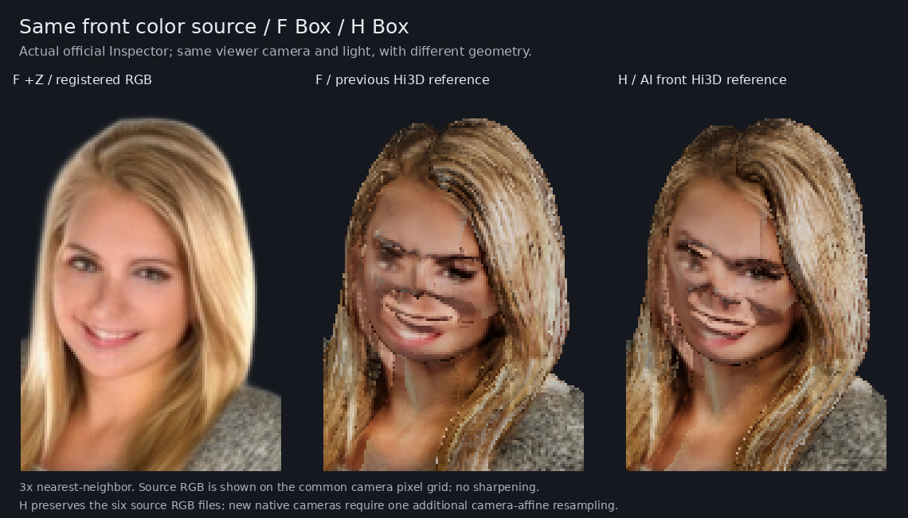
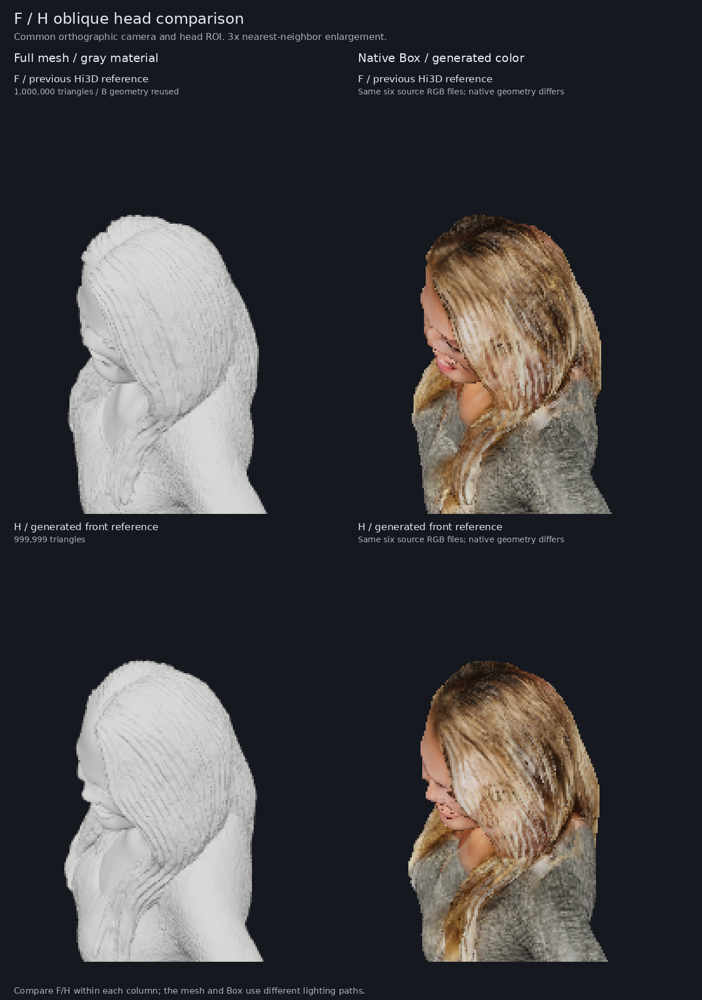
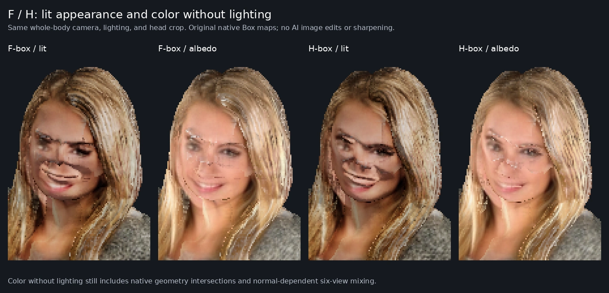
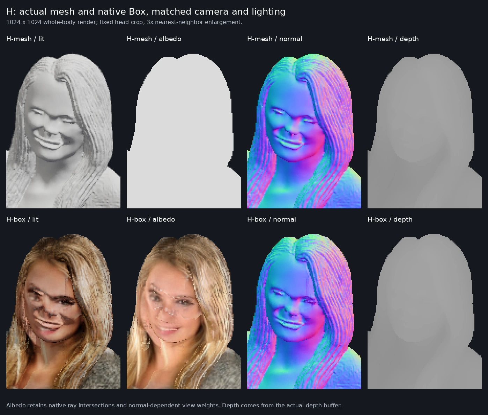
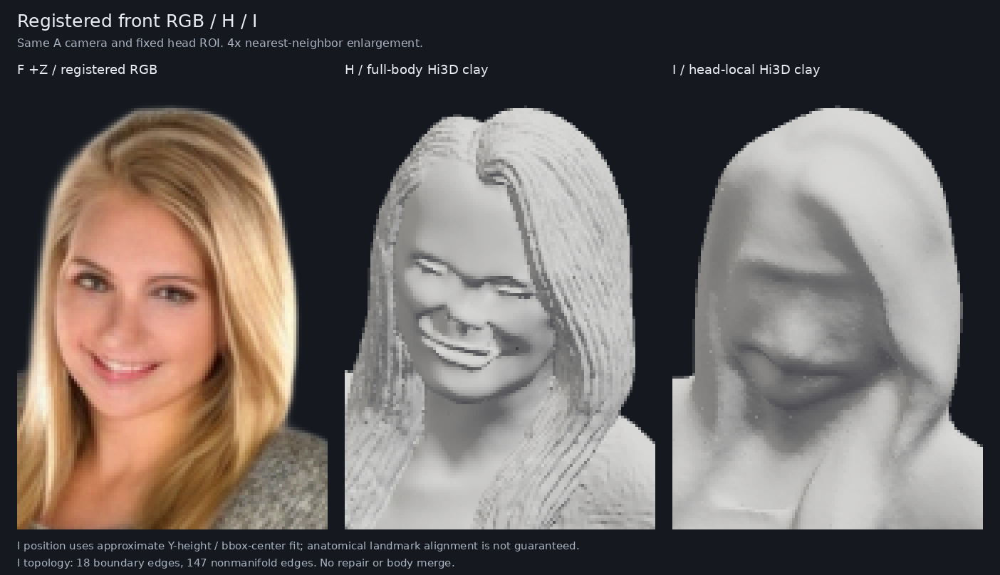
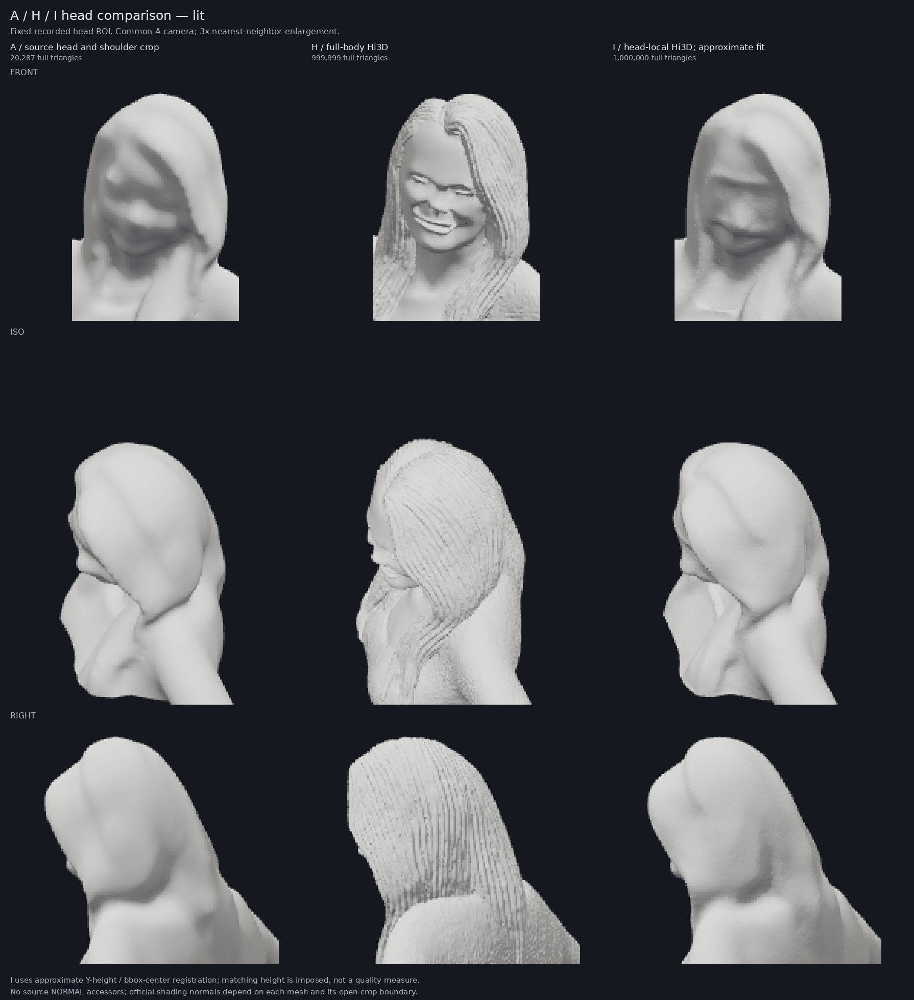

# H比較の再開と顔形状の診断

## 判定

Hの比較を再開し、F/Hの正面・左右・背面と斜めからの画像をそろえた。Hでは形状が変わったが、目・鼻下・口の帯状の崩れが残っている。今回の画像から、顔の問題を解消したとは判定しない。

続けて頭部と肩を切り出したHi3D試験Iを実行した。推論は正常終了したが、髪や顔の細部がHより弱く、粗い入力形状に近い結果になった。Iの全身への採用は見送った。

本番と同じBox描画処理で照明・色・法線・深度を分けたところ、FとHの両方で、照明を外すと目・鼻下・口の帯が薄く見えた。対応するメッシュの法線にも、帯と同じ位置に強い変化がある。生成RGBと形状・法線の不一致が、照明下の崩れに大きく関与していると考えられる。照明を外しても色の継ぎ目が残るが、元の方向別画像の不一致、再投影、色の混合の影響は個別には分けられていない。

## 再開した範囲

停止時点のH推論とBox合成は完了していた。今回はその結果を再利用し、未コミットだった4方向の比較画像について、元データ・カメラ・全三角形数・画像ハッシュの検査を再実行した。H推論そのものは再実行していない。斜め方向の3D-Inspector撮影と、後述のF/H描画診断は今回追加した。

以前の「Gテスト用ルート」に対応する実験条件は、今回アクセスできた保存済みファイルと実行履歴からは確定できなかった。続く頭部の試験には新しい識別子 `I-head-local` を付け、回収できていないGの再実行とは区別した。

## F/Hの比較条件

| 項目 | F | H |
|---|---|---|
| 粗い入力メッシュ | Aを使ったBのHi3D形状を再利用 | Bと同じA |
| Hi3Dの参照画像 | 元の写真 | Fの採用済み+Z生成RGB |
| Hi3D設定 | Bの形状を再利用 | 解像度1024、25 steps、seed 0、CPU offload |
| 形状の後処理 | B当時の処理 | B当時のスナップショット、smoothing 0 |
| 全身メッシュの三角形数 | 1,000,000 | 999,999 |
| Boxに使う6面の元RGB | F | Fの `source.png` と `source.npy` を全6面で保持 |
| カメラへの色の再配置 | Fの既存結果 | Hのカメラに合わせた決定的なアフィン変換 |

B当時の後処理を保存済みのB生メッシュに適用すると、元のB canonical GLBとバイト単位で一致する。この対照実験ではその処理を使い、後の色保存処理の修正を形状比較に混ぜていない。[B再現の検査](H-run/b-replay/proof.json)と[H実行条件](H-run/plan.json)を参照。

固定したのは元RGBファイルである。Hでは元の形状境界とベイク用カメラが変わるため、`aligned.npy` と最終カラーアトラスはFと一致しない。自由な位置合わせの最適化は行っていない。[H合成結果](H-run/result.json)と[カメラ変換の記録](H-run/camera-rebase/camera-rebase-proof.json)に保存している。

Fの+Z参照は全身1024×1024の画像であり、顔だけを1024pxで生成した画像ではない。またFで新しい生成条件を使ったのは−X面であり、全6面を同じ新条件で再生成した結果ではない。

## 3D-Inspectorでの比較

公式 `view.py` が生成したHTMLを変更せずに撮影した。メッシュは全三角形を含め、ビューアの既定の三角形数制限による欠落を避けた。Aの参照境界から決めた正投影カメラと共通の頭部領域を使い、頭部は最近傍補間で拡大している。輪郭検査の通過と顔の形状の一致は別々に判定した。

左はFの+Z RGBを共通の表示カメラ格子に載せた参照画像、中央がFのBox、右がHのBoxである。Hでも目の周辺と鼻下・口に、RGBにない帯が残る。

斜め方向でもHの鼻・口の形状は変わっているが、Boxには帯状の崩れが見える。この角度では髪が目を隠すので、目の位置の評価には正面画像も必要である。灰色メッシュとBoxにはそれぞれの公式描画経路があるため、F/Hの変化は同じ描画経路内で比較する。[4方向の比較記録](F-H-comparison-provenance.json)と[斜め方向の比較記録](F-H-iso-provenance.json)を参照。

## 色・法線・深度の診断

診断スクリプトは本番の `restoreBox` と保存済みのネイティブマップを使う。FとHの正面を、同じ1024×1024の全身カメラと照明で描画し、同じ頭部領域 `[463,115,572,271]` を比較した。これは内部の検査用描画であり、配布する3D-Inspectorを変更したものではない。

`albedo` は照明を加える前の色である。ただしBoxの形状との交差、法線に応じた方向の選択、6方向の色の混合は残る。したがって、この表示の改善だけで形状や再投影が正しいとは言えない。

深度は実際の深度バッファから読み出した。次の値は両方の輪郭が重なる頭部画素での、視線方向の深度差の絶対値である。単位は全身の高さを1とするcanonical座標である。

| 比較 | 頭部マスクIoU | 深度差の中央値 | 深度差の95百分位 | 深度差の最大値 | 法線角度差の中央値 |
|---|---:|---:|---:|---:|---:|
| BメッシュとF Box | 0.997616 | 0.00036188 | 0.00070933 | 0.04235794 | 3.505° |
| HメッシュとH Box | 0.998806 | 0.00038933 | 0.00073216 | 0.04418559 | 3.414° |
| BメッシュとHメッシュ | 0.989613 | 0.00175934 | 0.00820901 | 0.04614484 | 18.071° |

最初の2行は、各Boxが自分の元メッシュをどの程度再現しているかを測っている。実測した人物の形状との誤差ではない。共通の前景画素内の最大値も示した。片方だけが覆う画素は深度・法線の統計から除外し、輪郭の差はIoUで扱う。F/Hの近い数値から、人物の再現精度が改善したとは判定しない。

メッシュの法線には全三角形を含む公式3D-Inspectorのデータを使った。Boxの法線にはベイク済みマップを使うため、法線を作る方法やサンプリングの違いも角度差に含まれる。

メッシュとBoxで、法線の強い変化と照明下の帯が対応することから、今後は生成RGBに合う顔の形状を優先して検証する。[数値と画像の記録](resume-diagnostics/paired-diagnostics.json)と[実行条件・再計算方法](resume-diagnostics/evidence-index.json)を参照。

## 頭部と肩を切り出す試験

新しい試験 `I-head-local` はHと同じAのcanonicalメッシュの `Y >= 0.27` を残し、Fの+Z画像から対応する画素を切り出す。平面をまたぐ三角形は切断面まで分割し、人工的な蓋は作らない。

| 準備項目 | 値 |
|---|---:|
| 元の全身RGB | 1024×1024px |
| 切り出し画像 | 341×246px |
| 切り出し内の被写体範囲 | 325×229px |
| Hi3Dの画像前処理後 | 390×390px |
| 入力部分メッシュ | 20,287三角形 |
| 切断面の境界 | 519エッジ |
| 入力の非多様体エッジ | 0 |

これは頭部・髪・肩を含む既存画素の切り出しであり、新しい顔の細部を生成した画像ではない。Hi3Dの1024設定は形状抽出の解像度を指す。使用した実装では画像条件をDINO用756px、CLIP用224pxへ処理するため、形状の設定と顔のRGB画素数を同じ数として扱わない。

推論は353.45秒で正常終了し、500,011頂点・1,000,000三角形のメッシュを出力した。Hと同じ灰色材質にそろえ、全三角形を含む公式3D-Inspectorで正面・斜め・側面を撮影した。

Iでは髪の筋や目・口の細部がHより弱く、粗い入力Aに近い面が残った。鼻・口・眉の大きな凹凸も参照RGBに対応する形へ改善したとは確認できない。細かな帯が減って見えることを、顔の再現精度の改善とは判定しない。今回のIは全身への採用を見送った。

法線表示と、頭部の拡大範囲より広い画像でも確認した。Iは広く滑らかな髪の面と粗い顔の起伏を残しており、頭部の切り出し画像だけで細部が見落とされた結果ではない。[比較画像と条件](A-H-I-head-provenance.json)を参照。

位置合わせにはY方向の高さをそろえる等方スケールと、外接箱の中心をそろえる平行移動を使った。X方向の幅は元の約99.35%、Z方向の奥行きは約99.59%になったが、これは外形の値であり、目・鼻・口の位置精度ではない。Hi3Dの途中の正規化変換を最終GLBから厳密に逆算することはできないため、この位置合わせは近似として記録した。

出力には境界エッジ18本と非多様体エッジ147本がある。これらは生のHi3D出力にも存在し、今回の座標変換で生じたものではない。非多様体エッジはすべて下端から高さ5%以内にあり、顔の評価領域内にはない。顔の細部が改善しなかった原因を、この接続不良だとは断定していない。[形状と座標変換の検査](I-run/head-topology.json)を参照。Iは単独のメッシュとして評価し、全身への接合やBoxの再生成には進めていない。

この試験では入力メッシュと参照画像の両方を切り出した。結果の変化を形状抽出の解像度だけの効果とは解釈しない。[入力条件](I-run/head-plan.json)、[推論結果](I-run/hi3d-inference.json)、[座標変換](I-run/head-mapping.json)を保存している。

## 残る課題

Hでは元RGBの目・鼻・口と、照明下で見える形状の対応が未解決である。Iの結果から、同じ全身RGBを切り出してHi3Dへ渡す方法だけで、その対応を改善できるとは言えない。

次の候補は頭部用に生成するRGBと複数方向の形状条件をそろえる方法、または顔の特徴点を使って位置を拘束する方法である。今回これらは実行していない。新しい方法でも、灰色メッシュ・色・法線を分け、目・鼻下・口の位置と側面の形状を先に評価する。

## 検証と保存

F/Hの比較、斜め方向の撮影、ネイティブ描画診断について、入力・出力のハッシュと全三角形数を記録した。診断の元PNG16枚とfloat32の読み出し12個は、再計算用の圧縮アーカイブに保存した。Gitから取得したアーカイブを別環境で展開すると、これら28ファイルのハッシュは元データと一致した。再計算した統計には微小差があり、深度差の統計で最大約4.10×10⁻⁸、法線角度差の統計で最大約7.25×10⁻⁵度だった。輪郭IoUなどの他の比較値は一致した。[再計算の記録](resume-diagnostics/archive-recompute-check.json)を参照。

頭部の準備処理には9件のCPUテストを追加した。三角形の切断位置と向き、ノード変換、物理アスペクトを持つ元画像との対応、画素の保持、誤ったカメラや位置合わせの拒否、等方スケールと変換の可逆性を確認し、すべて合格した。

本番のBox描画処理とHi3D推論スクリプトは変更していない。今回の追加は比較・診断用スクリプト、頭部試験の準備処理、検証記録である。
