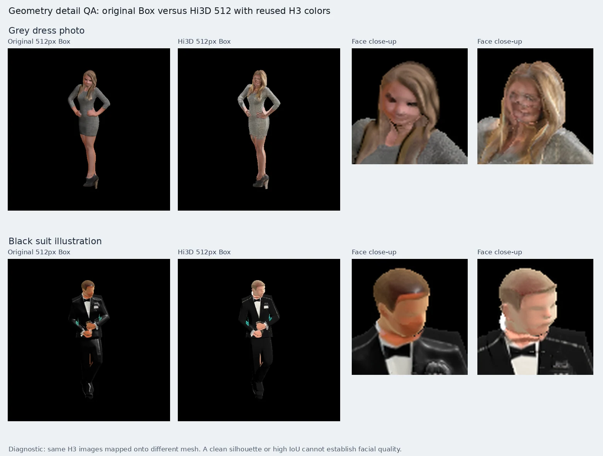
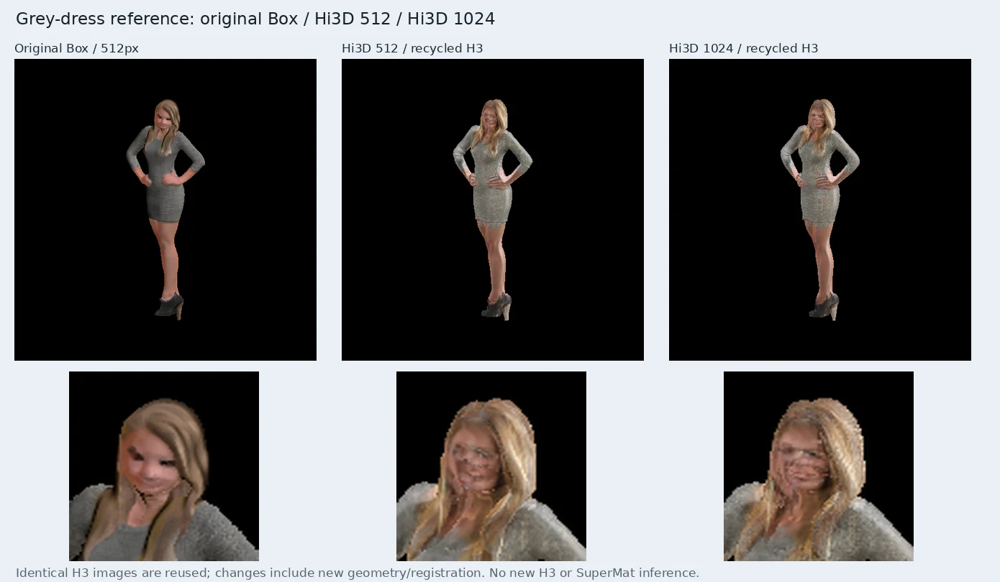

# 人物のディテール欠損を優先するHi3D追試（2026-11-18）

## 検証目的

人物が「溶けた」ように見える問題は、輪郭の欠損やメッシュ表面のざらつきだけでは説明できない。顔の凹凸、目鼻、手の分離、衣服のしわなど、元画像の局所的な形を再現できないことが問題である。

このため、人物全体のシルエットIoUや三角形数が増えても、細部の復元が確認できなければ品質改善とは扱わない。

## 512段階の実測結果

灰色ワンピースと黒スーツの元Box（各面512×512px）に対し、Hi3D 512段階で生成したメッシュを再ベイクした。比較用の着色は既存のH3画像を新しいBoxへ再配置したものであり、Hi3D向けにH3を再実行した結果ではない。

- 灰色ワンピースの正面：生成画像のマスクと新しいガイドのIoUが約0.769でも、顔の見え方は元Boxのほうが自然で、Hi3D版では顔周辺の色と形が崩れている。
- 黒スーツの正面：IoUが約0.900でも、顔の輪郭や首・手の周辺が不自然に見える。
- したがって、IoUは画像とガイドの位置合わせの確認に限り、顔・手・衣服のディテールが保たれたかを判定しない。

この比較には古いH3画像の再利用による位置ずれも含まれるため、形状だけの劣化量を直接示すものではない。ただし、この方法で作ったBoxが完成品質に達していないことは確認できる。

## 1024段階・平滑化なしの追試

RTX 4080 16GBで、同じ灰色ワンピースの入力画像とPixal3Dメッシュを用いて、Hi3Dの1024段階を実行した。CPUオフロードあり、25 steps、Taubin平滑化なしの条件で推論は完了し、出力は約50万頂点、100万三角形、処理時間は約408秒だった。最終Boxの各面は引き続き512×512pxである。

古いH3画像をそれぞれのBoxに再配置したとき、1024段階でも顔の崩れは解消していない。正面のIoUは約0.761で、512段階の約0.769より高くなっていない。三角形が増えたことやHi3Dの抽出解像度を上げたことは、人物の局所的な品質改善の証拠にならなかった。

画像の再利用に起因するずれも含まれるため、形状単体の優劣を断定しない。少なくとも現在の再ベイク方法では1024段階を品質改善策として採用できない。

## 実装上の修正

実験ノード「BI Hi3DRefineProxy」は通常のワークフローで無効（`bypass`）とする。Hi3Dを明示的に選ぶ実験ワークフローでも、Taubin平滑化を既定で行わず、`smoothing=none`にする。平滑化による法線角度の減少は細部復元の証拠としない。

今後は元画像との局所比較を優先し、同じカメラ角・縮尺で次の箇所を確認する。

1. 顔：目鼻の位置と凹凸、髪の塊が一体化していないか。
2. 手：指や手首が融合していないか、腕から手の形が自然につながるか。
3. 衣服：襟、袖口、すそ、しわなどに元画像由来の立体的な手がかりがあるか。
4. 背面・斜め：推定できない領域で関節や衣服が不自然に連続していないか。

現時点ではHi3Dを人物の品質改善として標準経路へ組み込む判断を保留する。512段階で輪郭が連続したことは確認できたが、顔・手・衣服の改善は確認できていない。
