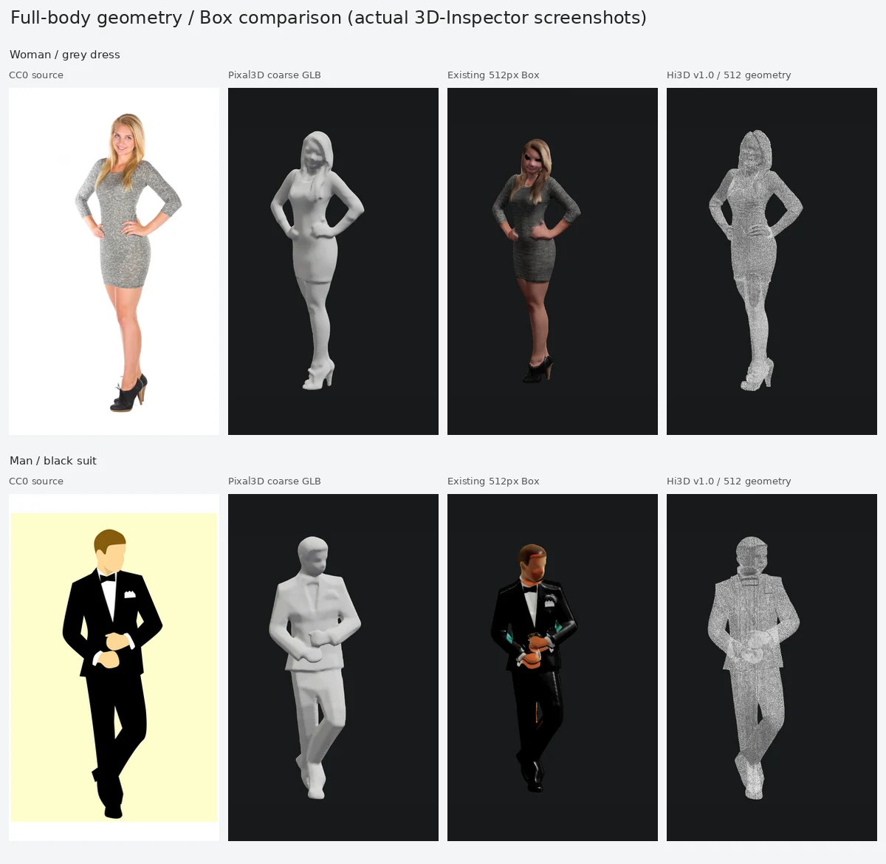
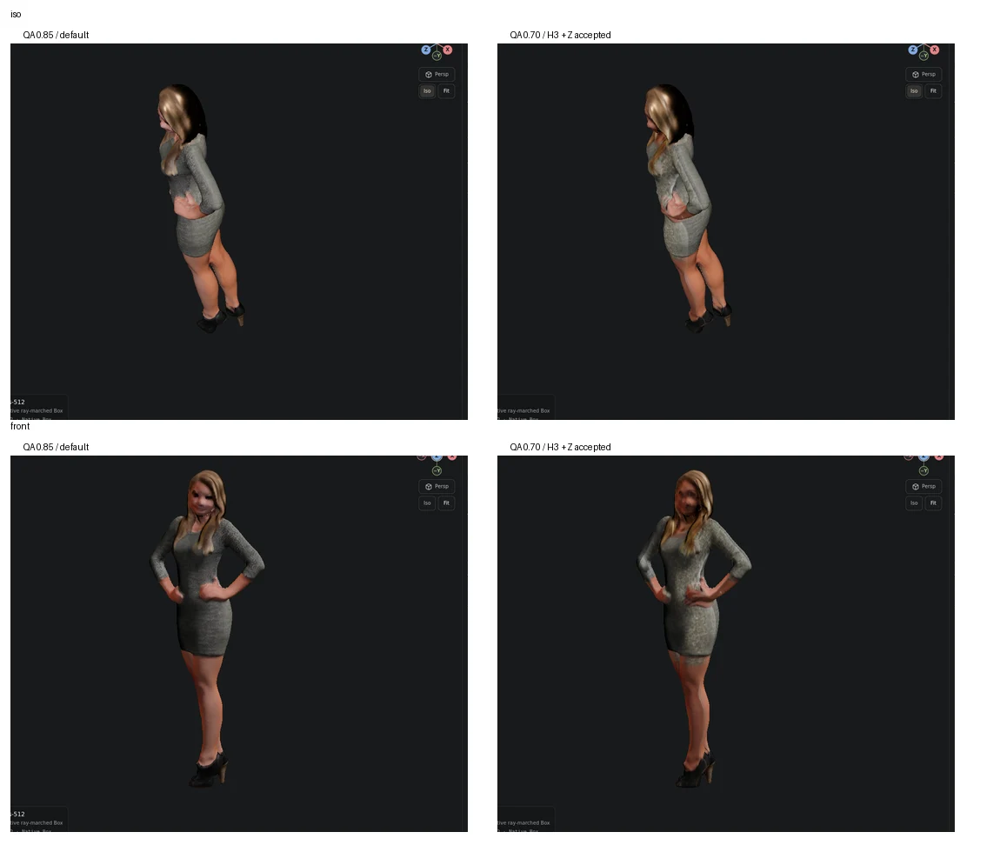

# Hi3D v1.0と輪郭QAの検証（2026-11-18）

Pixal3Dから生成したCC0全身人物2件を、Hi3D v1.0の512段階で改良した。元画像、メッシュ、512px Boxを3D-Inspectorで表示し、輪郭QAの採用基準を変更した結果とも比較した。

## Z（深度）の供給元

現在のワークフローでは、H3/Qwenが生成した画像は6方向のRGB・前景アルファに利用する。深度・法線・占有範囲はPixal3Dのメッシュからベイクする。`BIBakeBox`の既定の`depth_source`は`geometry`である。`rgb_guided`は生成RGBに従って既存メッシュの深度を局所的に補正して再ベイクするが、生成画像から独立した深度や欠損形状を復元する処理ではない。

`+Z`は正面の方向名でもあり、正面のカラー画像をAIで生成することと、奥行きのZ座標をAIで生成することは別の機能である。

参照: [`box_nodes/nodes.py`](../../../box_nodes/nodes.py)、[`box_nodes/depth_pipeline.py`](../../../box_nodes/depth_pipeline.py)、[`box_nodes/depth_refine.py`](../../../box_nodes/depth_refine.py)。

## 輪郭QAの役割

輪郭QAは画像生成の前景マスクと、既存メッシュから作ったガイドのIoUを測定する。これは「現在のメッシュに画像を貼れるか」の判定であり、「メッシュが元画像に対して正しいか」の判定ではない。

灰色ワンピースの`+Z`はIoU **0.771**、屋外写真の`+Z`は**0.713**であり、既定値0.85では不採用となった。両方の採用基準を0.70に下げると生成RGBを採用できたが、深度は変更されない。灰色ワンピースの3D-Inspectorでは斜めからの形状がほぼ変わらず、正面の色・顔・手の見え方だけが変化した。

したがって輪郭QAを廃止するよりも、**位置合わせの安全確認**として残し、生成画像とメッシュの不一致をメッシュ改良へ戻す診断情報として使う方針を推奨する。IoUの合格だけで最終3D品質を合格と扱わない。別途、深度・面間の連続性、顔や手の局所的な崩れ、最終ビューアでの再描画を評価する必要がある。

## Hi3D v1.0をRTX 4080で試した結果

[Hi3D v1.0](https://github.com/hi3d-official/Hi3Dv1.0)の公開推論実装（`13657ad`）を独立したPython 3.10環境に導入し、CC0画像と既存Pixal3D GLBから、512段階・25 stepsの推論を実行した。CUDA 12.4、PyTorch 2.5.0、FlashAttention 2.7.4、spconv-cu120 2.3.6を使用した。

| 被写体 | Pixal3D（頂点 / 三角形） | Hi3D（頂点 / 三角形） | Hi3D処理時間（読込含む） | PyTorch最大GPU割当 |
|---|---|---|---:|---:|
| 灰色ワンピース（写真） | 49,522 / 81,180 | 175,808 / 351,640 | 46.49秒 | 6,605.73 MiB |
| 黒いスーツ（イラスト） | 52,666 / 89,192 | 199,455 / 398,948 | 47.64秒 | 6,649.68 MiB |

2件とも推論完了。512はHi3Dのメッシュ抽出グリッドの呼称であり、最終Boxの**各面512×512px**とは独立している。Hi3Dの1024段階・1536段階はこのRTX 4080では未検証である。

[灰色ワンピースの3D-Inspector](grey-hi3d-512-3d-inspector.html) · [スーツ姿の3D-Inspector](suit-hi3d-512-3d-inspector.html)

## 品質評価と統合上の制約

Hi3Dは人物の全体輪郭を保持し、灰色ワンピースでは元メッシュの連結成分が144から1になった。しかし照明付き3D-Inspectorでは、両ケースの表面に細かいちらつき・凹凸が見える。灰色ワンピースで明示的な頂点法線を付けても、4回の軽いラプラシアン平滑化を行っても解消しなかった。無照明の診断では輪郭が保たれていたため、形状の完全欠損とは異なる表面品質問題として記録する。

Hi3Dの出力にはテクスチャ・材質・頂点色がなく、座標も正規化される。既存Boxのカラー・深度・法線・輪郭を流用すると位置が合わなくなる。採用する場合は、Pixal3Dメッシュの直後、六方向ガイド作成の前に**選択可能な実験的メッシュ改良経路**として置き、座標とカメラを合わせた後に六面を再ベイクし、RGBの位置合わせとPBR推定をやり直す必要がある。**本検証ではBoxへの統合・品質改善は確認していない。**

Hi3Dのコードと重みは一般的なMIT・Apache-2.0ではなく、[Hi3D Open License Agreement Version 1.0](https://github.com/hi3d-official/Hi3Dv1.0/blob/main/LICENSE)の対象である。商用利用は条件付きで認められ、表示・配布上の通知義務と、利用規模に応じた追加ライセンス申請条件がある。依存物のライセンスは別途確認する。

機械的な計測値と検証条件は[`results.json`](results.json)を参照。二つの3D-Inspector HTMLはモデルを内包する元の生成物を改変せずコピーしている。

**追試（2026-11-18）：** 平滑化では人物の「溶けた」ディテールを修復できない。元BoxとHi3D 512・1024段階を比較した結果、顔の視覚品質は改善していない。輪郭IoUだけではこの劣化を検出できない。比較画像と制約は[ディテール欠損の追試](DETAIL_LOSS_FOLLOWUP.md)を参照。
