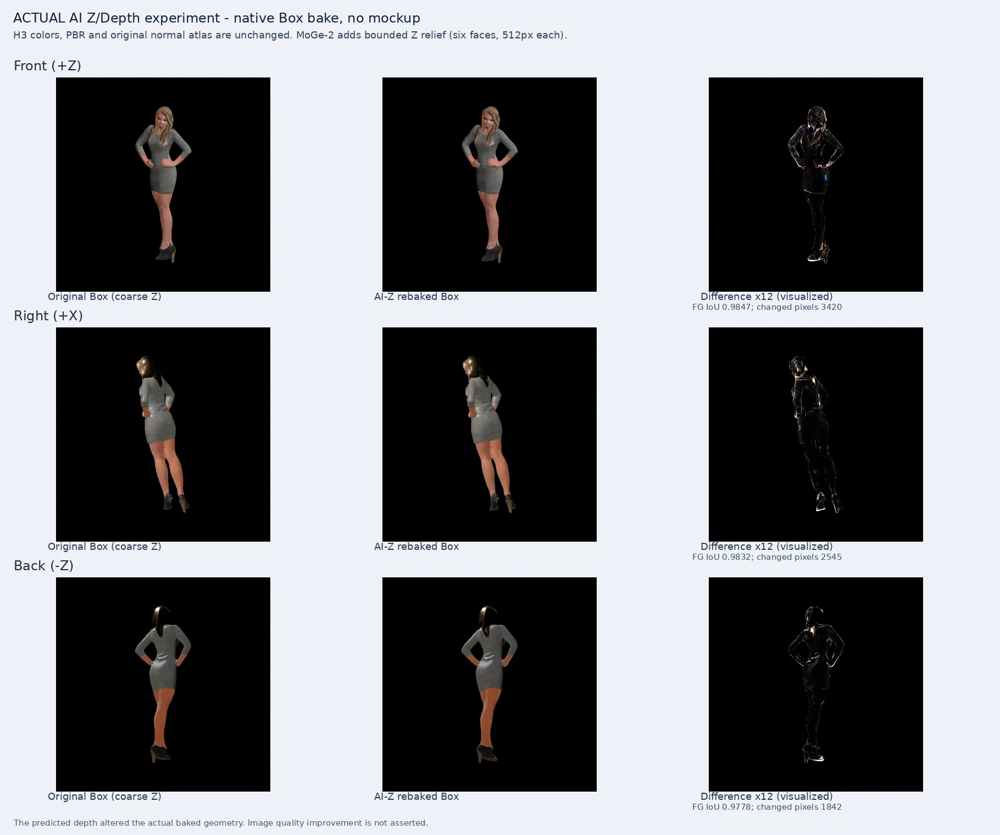

# MoGe-2によるAI深度ディテール追加の実装・実機検証

検証日：2026-11-18。270-PCのRTX 4080 16GBを使用。これは画像生成による完成予想図ではなく、保存済みのCC0人物・H3出力・Pixal3Dメッシュに対して推論し、ネイティブBakerで再ベイクした**実物のBox Impostor**である。

## 実際の結果

- [3D-Inspectorで実際のBoxを確認](woman-moge2-neural-z-512-3d-inspector.html)
- [再ベイクしたBoxの実データ（.box.zip）](woman-moge2-neural-z-512.box.zip)
- [6方向の実際の深度推論・差分](predicted-six-face-depth.webp)

最終Boxは各面512×512px、6面。元のRGB、normalMap、materialMapはバイナリのSHA-256が一致するよう保存した。これにより、RGBやマテリアルの差をZの改善と取り違えずに比較できる。

| 実測項目 | 結果 |
|---|---|
| AI深度の入力 | H3で生成した実画像6方向 |
| AI深度モデル | ComfyUI内蔵MoGe-2 ViT-L、resolution_level=8、推論画像最大辺768px |
| Pixal3Dの元メッシュ | 49,522頂点 / 81,180三角形 |
| 位置を変更した頂点 | 39,962頂点 |
| 追加変位の最大値 | 0.008566（元メッシュ高さ=1） |
| 追加変位の平均値 | 0.001137（同上） |
| 一部の頂点だけ変位を抑えた数 | 920 |
| 正面・右面・背面の前景IoU | 0.9847 / 0.9832 / 0.9778 |

正面・右面・背面の各768×768レンダリング画像では、RGB絶対差の前景平均は2.86、2.36、2.27（0〜255換算）。差分画像の明るさは見やすいように12倍にしている。数値・元データは[比較メトリクス](actual-comparison-metrics.json)に保存。

**現時点では顔・手・衣服の「溶け」を明確に改善したとは判定できない。** 実際のZをAI由来で変化させ、Boxを再ベイクする経路の成立は確認できたが、生成深度の局所的な細かさには限界があり、見た目の差は小さい。過大な補正では形状や法線の乱れが増えるため、強度を制限している。

## 実装内容

BINeuralDepthDetailノードを追加した。BIBakeBoxの既存のdepth_sourceにもmoge2_detailを追加した。標準のgeometry経路は変更していない。

処理は以下の順に進む。

1. Pixal3Dからベイクした各面の粗いZと、H3/Qwenが実際に生成したRGBAを読み取る。
2. 各画像の前景を自動トリミングし、ComfyUIのMoGe-2で新しい深度を推論する。
3. H3のguideRectの逆変換を使って深度をBoxガイド上に配置し、AI深度の局所高周波成分だけを抽出する。
4. 既存深度の前後関係・前景マスク・対向面の厚み制約を守り、元のメッシュの可視頂点を変位させる。局所的な三角形の反転だけを抑制する。
5. ネイティブBakerで6面すべてのZ・範囲・ガイドを作り直す。
6. 比較のため、元のH3カラー・法線・PBRは維持する。独立した深度の寄与を測定できる。

実験ワークフローは[12_box_from_reference_h3_ai_depth.json](../../../workflows/12_box_from_reference_h3_ai_depth.json)。Pixal3D → H3六方向 → 512px Box → MoGe-2深度補正 → SuperMat → プレビュー・保存。モデル重みはこのリポジトリに追加せず、ComfyUIのmodels/geometry_estimation/moge_2_vitl_normal_fp16.safetensorsを利用する。

## 未解決

- MoGe-2は画像からZを推定するニューラルモデルだが、今回の顔の細部を高精細な凹凸へ完全復元できていない。
- RGBの微細な模様を3D形状と誤認すると、強い補正で縞・表面ノイズが発生する。元の法線とカラーを固定するとこの症状を抑制できる。
- 各面のAI推定は独立なので、対向面の安全制限だけでは面間の完全な幾何学的一貫性を保証できない。
- 精細化をさらに進めるには顔・手の領域別深度推定、複数ビュー整合、より高密度の形状表現と客観的な外観QAが必要。

3D-Inspectorは既定のview.pyで生成したHTMLを改変せず収録した。開くと正面・背面・側面・斜めを回転して確認できる。
