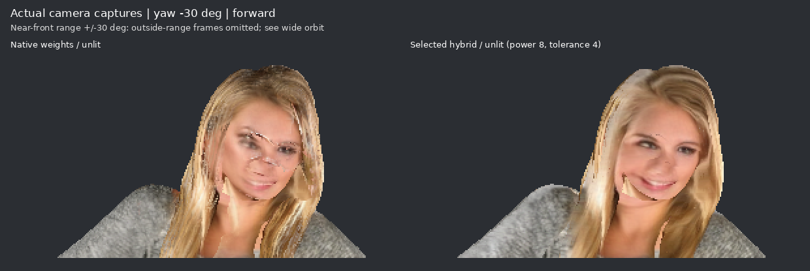
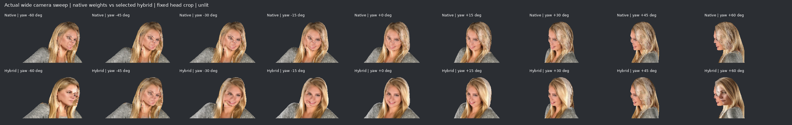
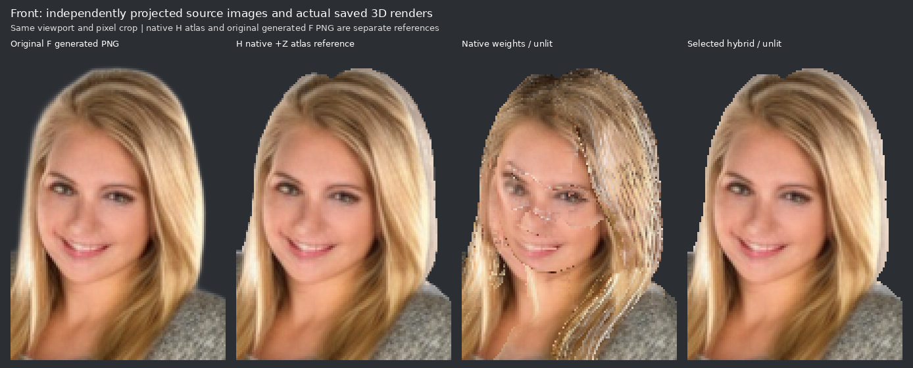
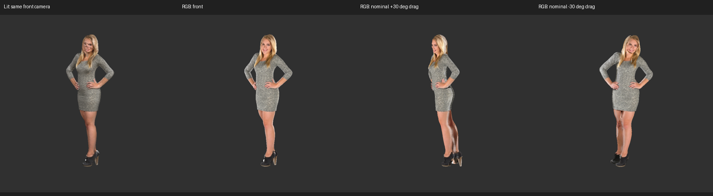
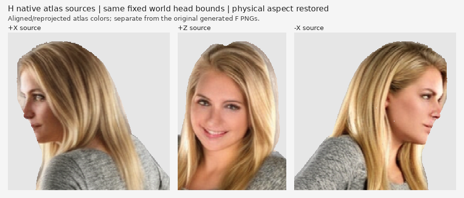

# 生成RGBを保つBox視差表示の検証

検証日: 2026年11月19日

## 結果

保存済みのHを使い、生成RGBを追加の照明で変えずに表示する「RGB視差」をFactoryに追加しました。正投影での頭部比較では正面の色が元画像に近づき、左右30度付近でも顔に重なる別の面の断片が減りました。一方、45度では髪と目の周辺に継ぎ目が残り、60度では顔の崩れが目立ちます。実際の透視表示では、正面付近から回しても顎・首や脚に乱れが残りました。全身を自然に回して見せるという目標は未達です。

採用した設定は `camera-hybrid`、`cameraPower=8`、`depthToleranceTexels=4` です。カメラの向きと深度の一致度でRGBを選び、法線を色の選択にだけ補助として使います。法線による再照明は行いません。元のRGB、Boxの交差判定、輪郭、深度を固定して比較しました。



上の動画は正面付近を見比べるための範囲限定表示です。左右30度以内を合格範囲としたものではありません。例えば負側15度でも顎下に帯状の乱れが残ります。広い角度で残った不具合は、次の比較にも含めています。



## 何を変えたか

元の方式は照明を切った状態でも複数面のRGBを法線に応じて混ぜます。そのため正面でも側面のRGBが入り、目や口に別の面の断片が見えました。照明を切るだけでは、この色合成は変わりません。

今回の実装はネイティブのレイとBoxの交差位置をそのまま使い、その位置に与えるRGBを変更します。カメラに向いた面を優先し、保存された深度から離れた候補の重みを減らします。法線による補助を加えると、斜めの髪に正面の顔が重なって見える症状が弱まりました。正面の単一面を選ぶ場合は、そのRGBを直接返します。

| 比較した方式 | 見た目と判断 |
|---|---|
| 標準のRGB合成、照明なし | 正面にも目・口の断片が残りました。比較の基準です。 |
| カメラに最も向いた1面を選択 | 正面は改善しましたが、面が切り替わる角度で見た目が急に変わります。 |
| カメラの向きで複数面を混合 | 斜めで顔が二重に見えるため採用しませんでした。 |
| カメラの向きと深度で混合 | 正面付近は改善しましたが、45度付近で髪に顔の模様が残りました。 |
| 上記に法線による補助を追加 | 正面を保ち、斜めの重なりが一部改善したため、今回の候補に採用しました。 |

深度の許容幅を4 texelから1 texelへ狭める比較も行いましたが、45度付近の重なりは十分に改善しませんでした。入力画像間の違いがあるため、許容幅の調整だけで解決したとは判断していません。

実装は [parallax_material.mjs](../../../worker/parallax_material.mjs) にあります。`three-impostor@0.4.1` の既存処理を呼び出しており、交差判定を別の形状に置き換えていません。この依存先の内部メソッドを使うため、依存バージョンを更新する際には交差位置と深度の比較が必要です。

## 正面RGBとの一致



数値は正面の頭部における、sRGBの8 bitコード値でのRGB絶対差です。平均と95パーセンタイルは、選択した全画素のRGB全チャンネルをまとめて計算しています。0に近いほど参照画像に近くなります。輪郭境界の影響を減らすため、両画像の不透明領域が重なる部分を2回収縮して測りました。収縮には4近傍の十字形を使っています。

| 独立した参照画像 | 比較画素数 | 標準合成の平均差 | RGB視差の平均差 | RGB視差の95パーセンタイル |
|---|---:|---:|---:|---:|
| Hの保存済み正面アトラスを同じカメラに投影 | 12,809 | 14.38334 | 0.313516 | 0.745933 |
| 元のF生成PNGを記録済みの投影で配置 | 11,857 | 13.33616 | 0.613794 | 1.871871 |

HのアトラスはFの元画像をHへ位置合わせした結果です。元の生成PNGと同じファイルとしては扱っていません。参照画像は各方式のレンダーから作らず、保存済みの入力から独立に計算しました。Hアトラスを参照した比較では、RGB視差の96.41%の画素が全チャンネルで1コード値以内に収まりました。値と参照元は [最終評価の記録](evaluations/H-hybrid-fine-001/summary.json) で確認できます。

この数値が示すのは正面の色の保存です。顔の3D形状が正しいことや、大きく回転した画像の自然さを保証する指標ではありません。入力は全身を含む1024×1024画像であり、顔だけを1024pxで新しく生成した結果ではありません。

## 視差と比較条件

Hの細かい回転比較では左右60度を3度刻みで撮影しました。41角度、2方式、往路と復路で164フレームです。復路は往路の画像を逆再生するだけでなく、各角度を独立に再レンダーしています。

82組の往復比較で、同じ角度のRGBA画像、RGBA8のアルファ、Float32深度、カメラ行列がすべて一致しました。Hの164フレームすべてで、RGBの方式を変えた後もネイティブのRGBA8のアルファとFloat32深度が完全一致しました。旧形状Fの18フレームと、5方式を比較した25フレームでも同じ検査を通りました。詳細は [capture-final-validation.json](capture-final-validation.json) にあります。

FとHは同じカメラで比較しましたが、形状に加えて位置合わせ後のアトラスの画素も異なります。この比較だけで見た目の差を形状だけの効果とは判断できません。各アセット内の表示方式の比較では入力マップと形状を固定しています。

視差の評価では、保存した深度とカメラ行列から表面点を次の視点へ移し、両方の画像に見えていると推定した点のRGBを比較します。画面上の同じ位置を比べるだけの差分は、自然な視差でも大きくなるため、品質判定には使いません。可視性の判定には近似があり、髪と顔の近い面や内部の境界を完全には区別できません。

3度ずつ移動したときの、深度で位置を合わせた表面点のRGB差は次のとおりです。値はlinear RGBの絶対差を対象点数で重み付けした平均です。小さいほど、今回比較できた点の色が回転中に変わりにくいことを示します。

| 頭部の比較範囲 | 標準合成 | RGB視差 | 可視性の条件を通った割合 |
|---|---:|---:|---:|
| 左右30度以内 | 0.0158134 | 0.00603488 | 96.91% |
| 30度を超え、60度まで | 0.0154149 | 0.0199909 | 97.07% |

正面付近ではRGB視差の色の変化が減りましたが、大きな角度では標準合成より増えています。この数値だけで、二重像がないことや顔の形が正しいことは判断できません。上の実画像と合わせ、今回の候補には角度による限界が残ると判断しました。

定量比較は正投影カメラです。通常のFactoryの透視表示は別に実画面で確認しました。正面RGBの顔は改善していますが、回転すると髪の後端、顎・首、脚の重なりに乱れが見えます。透視表示の角度は操作量からの目安で、上記の保存済みカメラ行列による正投影の角度とは区別しています。正投影用の数値を透視表示の評価値として流用しません。



透視表示の実行条件は [factory-perspective.json](factory-perspective.json)、動画のデコード確認は [factory-perspective-video-qa.json](factory-perspective-video-qa.json) に保存しました。

正面付近の頭部で改善したという判断を全身や透視表示にも同じ角度範囲で当てはめることはできません。検証用レンダーの処理時間は操作時のGPU性能を示すベンチマークとして扱っていません。

## 大きな角度で残る問題



Hに保存された元の面を比較すると、正面は歯を見せた笑顔ですが、左右の面は口を閉じ気味です。髪の位置にも違いがあります。この不一致は画像から確認できますが、すべての継ぎ目の原因をこれだけで特定したわけではありません。生成RGBと保存された形状の対応にも限界が残っています。

角度を変えてRGBを混ぜると、異なる口や髪の位置が重なります。1面だけを選ぶと重なりを減らせる一方、切り替え時の差が表に出ます。今回の候補はこのトレードオフを正面付近で改善したものです。大きな角度まで自然にするには、面同士で同じ顔・表情・髪の位置を保てるか、形状への投影が合っているかを次の検証対象にする必要があります。

髪の線状の乱れを調べた範囲では、アルファが抜けた内部の穴ではなく、不透明なRGBの違いでした。また、途中の試作で生じた黒い点には別の実装不具合がありました。RGBの計算結果が条件分岐の内側だけで代入され、後から未初期化の変数が参照されていました。計算を分岐の前に移すと、45度の対象フレームにあった不透明な全黒画素988個は0個になりました。修正前後のシェーダーと確認結果を [tsl-rgb-scope-verification.json](tsl-rgb-scope-verification.json) に保存しています。

## Factoryでの使い方

検証用ブランチ `experiment/rgb-parallax-20261119` で利用できます。Factoryビューアの「描画」から「RGB視差」を選びます。ComfyUIでは `BIPreviewBox` または `BIRenderBox` の `shading` を `rgb` に指定します。

CLIの例です。`/absolute/path/to/saved-box` は既存のBoxアセットのディレクトリに置き換えます。

```bash
node worker/cli.mjs preview --asset /absolute/path/to/saved-box --shading rgb
```

```bash
node worker/cli.mjs render \
  --asset /absolute/path/to/saved-box \
  --output /absolute/path/to/rgb-front.png \
  --view +Z --projection orthographic \
  --width 1024 --height 1024 --shading rgb
```

RGB表示への切り替えでは保存済みのマップを再利用します。新しいHi3D推論やRGB生成は不要です。既存ワークフローの省略時の設定は `lit` で、RGB表示は明示的に選択します。プレビューとサムネイルのキャッシュは表示モードを区別します。

## 再現用の記録

入力F/Hのマップのハッシュと比較の固定条件は [plan.json](plan.json) に保存しました。Inspectorから復元した表示用のmanifestと、撮影に使った完全なFactory manifestはメタデータの範囲が異なるため、ハッシュを別々に記録しています。撮影時の完全なmanifestのハッシュは `capture-final-validation.json` と各 `sweep.json` でも確認できます。どちらの復元方法でも、今回使ったネイティブのマップのバイト列は一致します。

撮影には [capture_parallax_sweep.mjs](../../../scripts/capture_parallax_sweep.mjs)、評価には [evaluate_parallax_sweep.py](../../../scripts/evaluate_parallax_sweep.py) を使いました。撮影時のソースのハッシュもフレームの記録に含まれます。

元の3D-Inspector HTMLは変更していません。このページの比較画像と動画はFactoryの実レンダーです。3D-Inspectorの標準表示に今回のRGB合成を実装したものとしては扱っていません。

生フレーム、Float32深度、評価結果、撮影時のソース、失敗した試行、Factoryの元動画は、[検証データのブランチ](https://github.com/zkamiyama/ComfyUI-Box-Impostor-Factory/tree/verification/rgb-parallax-20261119/docs/verification/rgb-parallax-20261119/archive) に保存しました。入口は `rgb-parallax-evidence-20261119-index.json` です。分割アーカイブの一覧とハッシュを含みます。

アーカイブとindexを同じディレクトリに保存すると、`experiment/rgb-parallax-20261119` ブランチのスクリプトで内容を確認できます。

```bash
python scripts/archive_parallax_evidence.py verify \
  --index /absolute/path/to/archive/rgb-parallax-evidence-20261119-index.json
```

ネイティブの大きなマップは重複保存せず、以前に保存した変更のないInspector HTMLから復元します。取得するGitコミット、ファイルのパス、HTMLとマップのハッシュ、復元コマンドはアーカイブのinventoryに記録しています。復元時には撮影に使った完全なFactory manifestを使い、Inspector内の表示用manifestも別ファイルで保持します。

検査では実際のFactoryの表示切り替え、CLIのRGBレンダーとサムネイル、元マップの不変性を確認しました。評価用のCPUテスト6件、アーカイブ用のテスト5件も通っています。画像比較やデコード確認が通ったことと、見た目の目標を達成したことは区別しています。今回の完成判定は [final-assessment.json](final-assessment.json) に記録したとおり未達です。
