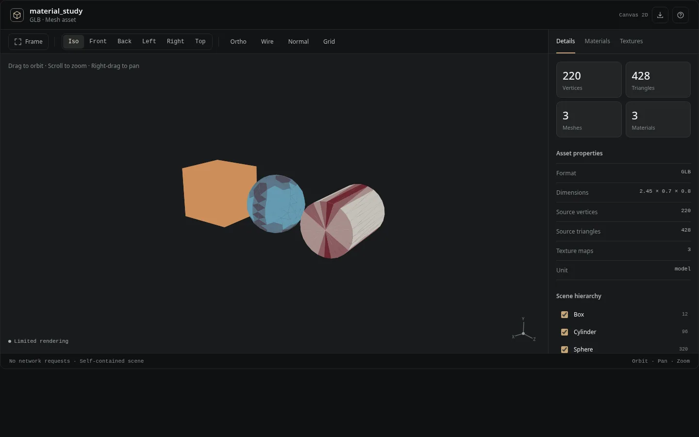

# Chat 3D Inspector

A reusable agent skill for building **one self-contained HTML file** to explore a 3D model. No remote JavaScript libraries, network requests, build tools, or local server are required *to view* the exported file.



The viewer has camera presets, orbit/pan/zoom, screenshot export, model hierarchy and visibility, live rendered vertex/triangle/mesh/material counts, dimensions, material properties and material isolation, and a texture browser with per-channel and UV inspection. On browsers without WebGL2 it uses a simplified Canvas2D renderer; texture sampling in the viewport is only available in WebGL2.

## Install in a coding agent

The public repository includes a ready-to-upload [Skill ZIP](../chat-3d-viewer.zip). For eligible ChatGPT workspaces, open **Plugins → Skills → Create → Upload from your computer** and choose the packaged Skill ZIP. Availability is controlled by the workspace and plan. Or copy this `chat-3d-viewer` folder to your coding agent's Skills directory, such as `~/.agents/skills/chat-3d-viewer` (Codex) or `~/.claude/skills/chat-3d-viewer` (Claude Code). In ChatGPT, make the files available to the agent through a suitable workspace or file-enabled environment. **Publishing the Skill makes it reusable, but does not automatically install it for every ChatGPT user.**

## Build a viewer

```bash
python -m pip install -r requirements.txt
python scripts/build_viewer.py model.glb -o model.inspector.html
python scripts/build_viewer.py model.box.zip --grid 96 -o model.inspector.html
```

Read the JSON printed by the builder for real preview counts. For GLB and other polygon formats, source counts are included. For a Box Impostor `.box.zip`, preview geometry is **sampled from the six depth guides and color atlas**; the native shader can produce richer results. The viewer UI labels this distinction.

Run tests with `python -m unittest discover -s tests`, optionally `python tests/browser_smoke.py` with Playwright and Chromium for a screenshot smoke check. The included HTML examples are generated from synthetic mesh fixtures and are free to share.

## Privacy and security

Assets are embedded within the exported HTML (compressed and base64-encoded); opening the viewer does not send them anywhere. Do **not** use the output for confidential models if you plan to share the HTML. The builder validates paths and checksums of Box archive members, caps data sizes, and uses text-only DOM updates to display names. For large or untrusted models, review the ZIP before processing and work in an isolated environment.

## Credit

The original UI and exporter are new code. The design audit and visual discipline were informed by [unslop](https://github.com/heydamir/unslop), created by Damir Sokolovsky, licensed [CC BY 4.0](https://github.com/heydamir/unslop/blob/main/LICENSE).
